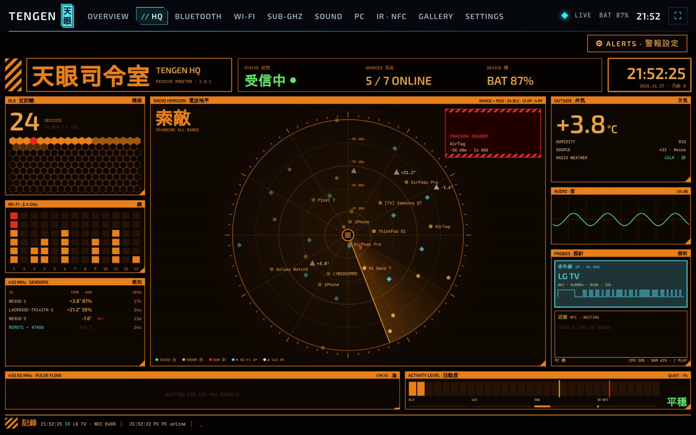
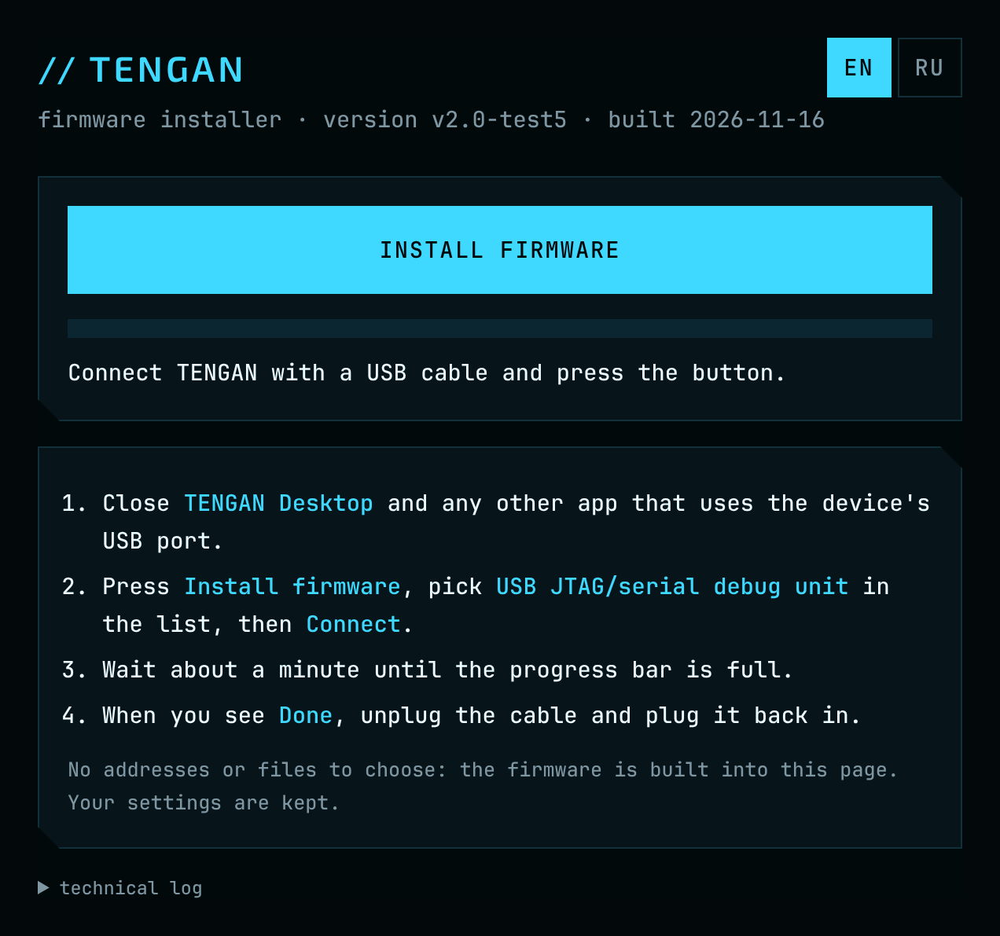
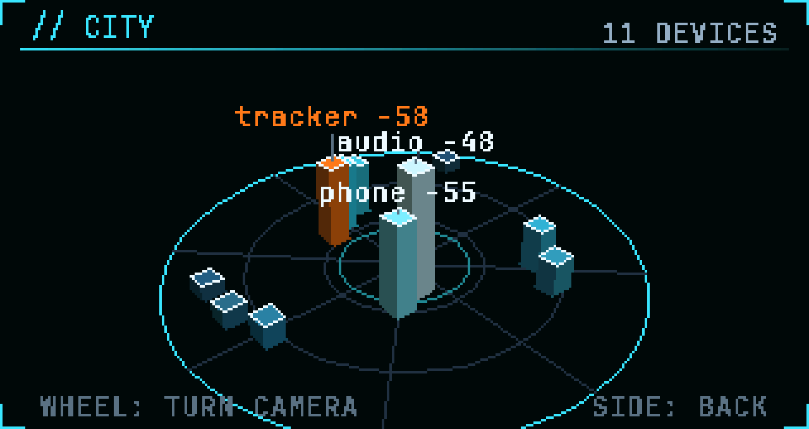
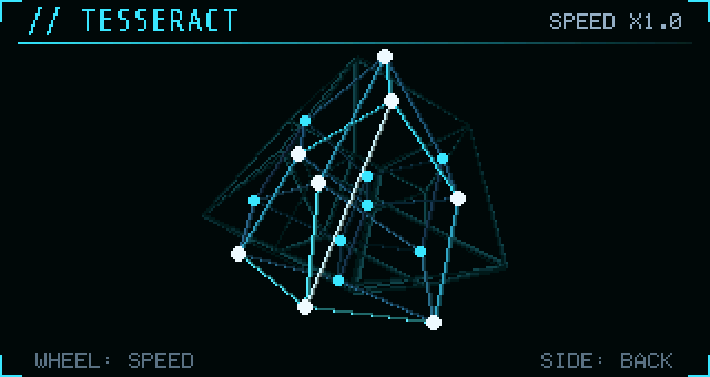
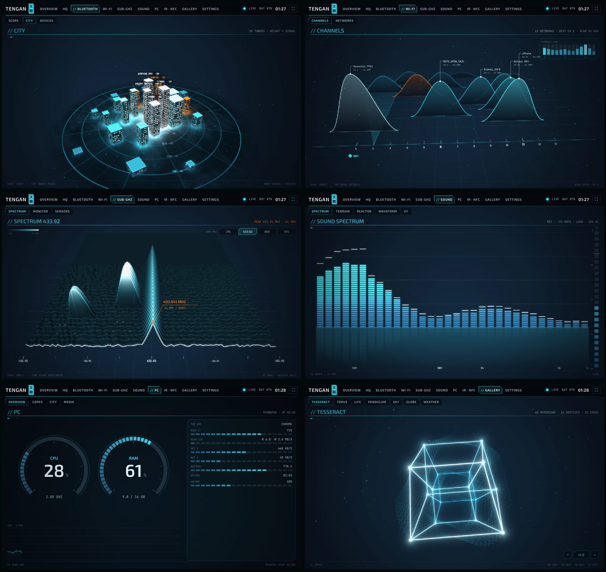
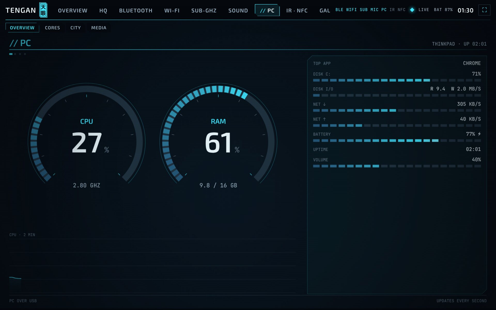
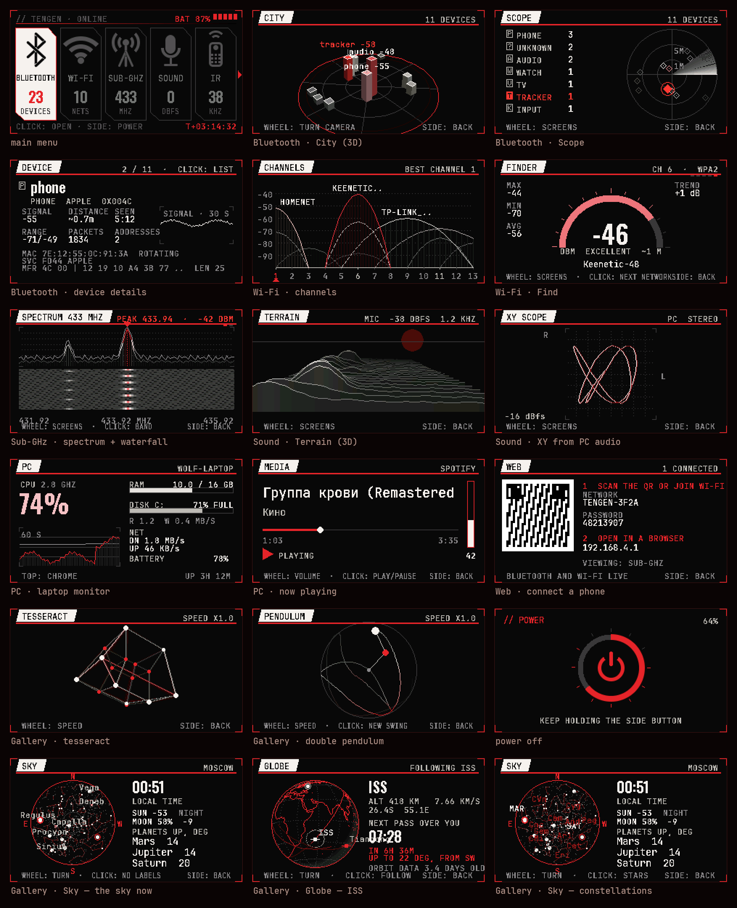

<div align="center">


# TENGAN 天眼

**See the invisible radio world around you — beautifully.**

Bluetooth · Wi-Fi · Sub-GHz · IR · NFC · sound · PC monitor turned into a living tactical HUD<br>
on the LilyGO T-Embed CC1101 Plus, on a tablet (TENGAN Tablet) and on a computer (TENGAN Desktop).<br>
**Receive only.** TENGAN never transmits on the air and never writes to cards.

[](https://github.com/wolfyboy1488/lilygostuff/releases/latest)
[](https://github.com/wolfyboy1488/lilygostuff/actions/workflows/build.yml)
[](LICENSE)


[**Download**](https://github.com/wolfyboy1488/lilygostuff/releases/latest) ·
[What you need](#-what-you-need) ·
[Quick start](#-quick-start) ·
[Sections](#-sections) ·
[Tablet & desktop](#-tengan-tablet-and-tengan-desktop) ·
[FAQ](#-faq) ·
[Build](#-building-from-source) ·
[**Русский**](README.ru.md)

</div>

---

> **天眼 (tengan)** is Japanese for "heavenly eye" — the sight that sees what is hidden and far away.
> TENGAN shows what your eyes can't: the radio world around you — phones, earbuds, routers, remotes,
> key fobs, outdoor sensors, cards.

<div align="center">

<br><sub><b>HQ</b> on a tablet: the radio horizon, alerts, sensors, sound, remotes and cards on one screen. The device sends numbers — the tablet draws.</sub>
</div>

## ✨ Features

| | Section | What it shows |
|:-:|---|---|
| 📶 | **Bluetooth** | how many devices are nearby and what they are: phones, earbuds, watches, **item trackers**; radar, 3D city, BLE thermometers |
| 🛜 | **Wi-Fi** | networks around you, channel load, air activity, finding the spot with the best signal |
| 📻 | **Sub-GHz** | 315 / 433 / 868 / 915 MHz: spectrum, waterfall, bursts; **433 MHz outdoor weather sensors** |
| 🔦 | **IR · NFC** | "whose remote?" — protocol, brand, button code; "what card?" — card or tag type |
| 🎙 | **Sound** | spectrum, 3D terrain, oscilloscope — from the microphone or from your computer's audio |
| 🛰 | **HQ** | everything on one screen: radio horizon, alerts, sensors, sound, remotes and cards |
| 💻 | **PC** | computer load, **now playing**, volume and track control |
| 🌀 | **Gallery** | 4D hypercube, torus, Life, pendulum, **planetarium**, **the ISS above you**, radio weather |
| ⚙️ | **Settings** | general, per section and **alerts** — the same on the device, tablet and computer |

<div align="center">

<br><sub>The 320×170 device screen at 2×. Every image is the real drawing code captured in the simulator.</sub>
</div>

## 🧰 What you need

| | |
|---|---|
| **Device** | **LilyGO T-Embed CC1101 Plus** (ESP32-S3, 320×170 screen, wheel, CC1101, IR, PN532 NFC, microphone, speaker, LEDs, battery). The non-Plus T-Embed CC1101 works too, without the NFC section |
| **To install** | a computer with **Chrome** or **Edge** and a USB-C cable — nothing to install |
| **Optional** | an Android tablet or phone (TENGAN Tablet), any browser on the same Wi-Fi, or a computer with TENGAN Desktop (Windows, macOS, Linux) |

## 🚀 Quick start

<table>
<tr>
<td width="55%">

1. Download the flasher from [**Releases**](https://github.com/wolfyboy1488/lilygostuff/releases/latest):
   **`flash_tengan.html`** — one firmware for English and Russian.
2. Connect the T-Embed to your computer with a USB cable and open the file in **Chrome** or **Edge**.
3. Press **Install firmware**, pick *USB JTAG/serial debug unit* and **Connect**.
4. When it says **Done**, reconnect the cable. At first start TENGAN asks for the language: **English** or **Русский**.

The firmware is inside the file — no addresses, no file picking. Settings are **kept** when you reflash.

> Later updates can go **over the air**: Web section → page → **Update** tab.

</td>
<td width="45%"></td>
</tr>
</table>

**Language** is chosen on the device (Settings › Language) — the tablet and desktop interfaces follow it.

## 🕹 Controls

| | Action |
|---|---|
| **Wheel** | switch screens · select a row · change a value |
| **Wheel press** | the screen's main action (details, frequency, pause…) — shown at the bottom |
| **Side button** | back: details → screen → screen list → main menu |
| **Side button, hold 2 s** | power off · power on — hold ~1 s |

A section runs **only while it is open**: in the main menu the radios, microphone and CC1101 are off, which saves battery.

<div align="center">

</div>

## 📡 Sections

### 📶 Bluetooth

<div align="center"></div>

| Screen | What it shows |
|---|---|
| **Overview** | how many devices are nearby, the 2-minute trend, what the crowd is made of |
| **Scope** | distance by signal strength; trackers highlighted |
| **City** | 3D: devices are towers; closer means taller and nearer the center |
| **Nearest** | the nearest device on a gauge, distance estimate, closer/farther ticks |
| **Devices** | list; press for details: addresses, services, vendor, signal graph |
| **Weather** | BLE thermometers: Xiaomi (PVVX/ATC), BTHome, Govee, Qingping, SwitchBot, Ruuvi |

<details>
<summary><b>How TENGAN recognizes devices</b></summary>

- **Type** (phone, computer, audio, watch, TV, tracker, beacon, sensor…) — from what the device broadcasts itself:
  name, Appearance, services, Apple message types (AirPods, AirTag, iPhone…).
- **Vendor** — the Bluetooth SIG database is built in: ~4000 companies and ~700 member services.
- **No duplicates.** Phones rotate random addresses; when one goes silent and a new one with the same
  "handwriting" appears, they are merged into one device.
- **Range** — Settings › Bluetooth › Range: from "all" to "very near" (−60 dBm).
- **Your own devices** can be named ("my AirPods") from the tablet or computer.

</details>

### 🛜 Wi-Fi

| Screen | What it shows |
|---|---|
| **Networks** | networks (strongest first): channel, security, open networks; press for details and the router vendor (~39,000 in the database) |
| **Channels** | each network is a hill of its real width on its channel — which of 1 / 6 / 11 is free |
| **Activity** | packets per second on each channel and air noise |
| **Clients** | how many devices are in each network and how many are looking for Wi-Fi — counts only |
| **Find** | the selected network's signal, big, with ticks — find where Wi-Fi is best |

<sub>ESP32-S3 sees 2.4 GHz only. Scanning is passive: packet contents are never read, only headers for counting.</sub>

### 📻 Sub-GHz (CC1101)

| Screen | What it shows |
|---|---|
| **Spectrum** | a ±2 MHz sweep around 315 / 433 / 868 / 915 MHz plus a **waterfall** — the air's history |
| **Monitor** | one frequency and its **bursts**: key fobs, gates, doorbells, sensors |
| **Sensors** | 433 MHz outdoor thermometers (Nexus, Rubicson, LaCrosse, Acurite, Bresser, Fine Offset…) and a pulse analysis of the last packet |

<sub>The radio is never switched to transmit. Remotes and doorbells show only a fingerprint; codes are not stored.</sub>

### 🔦 IR · NFC

- **IR — "whose remote?"**: point a remote at TENGAN and press a button. Protocol (NEC, Samsung, Sony, RC5/RC6, LG…),
  likely brand, address and button code, waveform, press history.
- **NFC — "what card?"**: touch a card or tag. Type (MIFARE, NTAG, DESFire, FeliCa…), a hint ("transit card",
  "tag"), public tag records. **Bank cards: number and name are never read** — only "is it a payment card".
  The UID is partly hidden.

### 🎙 Sound

32-band spectrum, 3D terrain, reactor, level meter, oscilloscope and X-Y figures.
**Source** — Settings › Sound › Source: auto / mic / PC. With TENGAN Desktop the screens follow the audio
playing on the computer — clean, no microphone.

### 🛰 HQ

One screen with everything: the radio horizon (Bluetooth, Wi-Fi, 433 MHz sensors), an air-activity level with a
per-source breakdown, outdoor temperature, sound, the last remote and card, an event log. HQ is styled per theme.

**Alerts** are configurable: what counts as "near", when a new device or a tracker raises an alert, sensitivity,
the attention and alarm thresholds, which sources count, blinking and the "接近警告" plate.
The same settings live in Settings › Alerts on the device, tablet and computer, and behind the ⚙ button on the HQ screen.

### 🌀 Gallery

<div align="center"></div>

**Tesseract**, **torus**, Conway's **Life**, **double pendulum** — beautiful on their own.
**Sky** — a planetarium over your city: ~1600 stars, constellations, the Sun, the Moon with its phase, planets.
**Globe** — the ISS, Tiangong and Hubble on their real orbits and the next pass over you.
**Weather** — "radio weather": clouds from the devices around, rain from 433 MHz packets, thunder from loud sound,
plus the temperature from an outdoor sensor.

<sub>City — Settings › General › City (or the tablet's GPS). Exact time and orbits come from TENGAN Desktop;
the device remembers them and keeps computing on its own, offline.</sub>

## 📱 TENGAN Tablet and TENGAN Desktop

<div align="center">

</div>

Every section at full screen resolution: a volumetric radar, the 3D city, Wi-Fi ridges, a deep Sub-GHz waterfall,
sound terrain, HQ, the gallery. TENGAN sends only numbers; the tablet or computer draws everything —
60 frames per second, no internet. The page is served **by the device itself**, so it always matches the
firmware and updates together with it.


| | How to connect |
|---|---|
| **Browser** (phone, tablet, computer) | open **Web** on TENGAN → scan the QR code or join `TENGAN-XXXX` → `192.168.4.1`. Choose **LITE** (a light page for phones) or **FULL** (the full scene) |
| **TENGAN Tablet** (Android, `tengan_tablet.apk`) | the same scene full screen, plus **GPS**: sky and globe use your coordinates. Install: copy the APK to the tablet, open it, allow installation |
| **TENGAN Desktop** (Windows `tengan_desktop.exe`; macOS / Linux — see below) | HQ and every section in a window **over the USB cable** (your computer keeps its internet) or over TENGAN's Wi-Fi. Includes the PC monitor: load, now playing, volume, PC audio for Sound, exact time and satellite orbits |

<div align="center">

<br><sub>TENGAN Desktop on a laptop: the PC section — load, memory, network, battery, now playing.</sub>
</div>

<details>
<summary><b>TENGAN Desktop details</b></summary>

- Start: connect TENGAN with a cable and run `tengan_desktop.exe` — the device opens Web by itself.
  Modes: **USB**, **Wi-Fi**, **Auto** (the last choice is remembered). F11 — full screen, F2 — mode choice.
- **Settings**: F2 → **⚙ Alerts & widget** — popups, the widget on top, and the window: interface scale (80–150%),
  open full screen, start with the system (straight to the tray). Window size and position are remembered.
- The track title comes from the Windows "Now playing" panel; if an app doesn't report it there, from the
  window title (Spotify, a YouTube tab).
- Log file: `%APPDATA%\TENGAN\desktop.log`.
- The EXE is not code-signed (that needs a paid certificate), so at first start Windows SmartScreen may say
  "Windows protected your PC" — press **More info → Run anyway**.
- The old console monitor `pc_monitor_windows.zip` is still in the releases but is no longer needed.

</details>

<details>
<summary><b>macOS and Linux (community builds, untested on real hardware)</b></summary>

The releases also carry **`TENGAN-Desktop-mac.zip`** (Apple Silicon) and
**`TENGAN-Desktop-linux-x86_64.AppImage`**. They are built and smoke-tested automatically, but nobody has
run them with a real TENGAN yet — reports are welcome.

| | macOS | Linux |
|---|---|---|
| HQ window, USB and Wi-Fi modes | ✅ | ✅ (Qt WebEngine) |
| Load, memory, network, battery | ✅ | ✅ |
| Media keys (play/pause, tracks, volume) | ✅ Spotify / Music + system volume | ✅ via `playerctl` + `pactl`/`amixer` |
| Track title | ✅ Spotify / Music | ✅ any MPRIS player or browser (`playerctl`) |
| PC audio for Sound | ❌ (macOS has no system loopback) | ✅ PulseAudio / PipeWire monitor |
| Popups, widget, tray | ✅ (notifications via the system) | ✅ (`notify-send`; tray needs AppIndicator or X11) |

- **macOS:** unzip, move **TENGAN Desktop.app** to Applications. The app is not signed by Apple, so the
  first time open it with **right-click → Open → Open**. The serial port is `/dev/cu.usbmodem…`.
  Log: `~/Library/Application Support/TENGAN/desktop.log`.
- **Linux:** `chmod +x TENGAN-Desktop-linux-x86_64.AppImage` and run it. Access to the USB port needs the
  `dialout` group: `sudo usermod -aG dialout $USER`, then log out and back in (the app shows this hint if
  the port is denied). Optional: `sudo apt install playerctl` (track title and media keys), `libfuse2`
  (to run AppImages on newer distros), `libportaudio2` (PC audio). Log: `~/.config/TENGAN/desktop.log`.

</details>

<details>
<summary><b>Over-the-air updates and rollback</b></summary>

Web → page → **Update** accepts `tengan_full_0x0.bin` and `tengan_firmware_ota.bin` from the release.
The new firmware goes to the second slot as a trial: if it does not run for 15 seconds, the bootloader
**restores the previous one** by itself.

</details>

## 🎨 Themes — DENKO 電光 and KURENAI 紅

The theme is chosen on the device: Settings › Theme. The tablet, phone and computer follow it.
Until a screen knows the device's theme, startup is plain black and white.

- **DENKO 電光** — a glowing HUD on a dark background: cyan neon, bloom, scanlines. HQ is orange.
- **KURENAI 紅** — manga punk: only black, white and red, skewed white plates, big condensed numbers,
  no glow — which also makes it faster.




## 🔒 Privacy, the receive-only principle and responsible use

- TENGAN **transmits nothing** on the air: CC1101 and IR are never switched to transmit, NFC only reads.
  The only thing the device emits is its own Wi-Fi access point for the tablet, while Web is open.
- It shows only what devices already broadcast to everyone around. Wi-Fi packet contents are never read,
  remote codes are not stored, bank card numbers and names are not read.
- Everything works **offline**, with no cloud: data never leaves the device and your tablet/computer.
- TENGAN is for looking at the radio world around you, not for interfering with it. Laws on radio reception and privacy differ
  between countries — use it where and how it is legal, and respect other people's privacy.

## ❓ FAQ

<details>
<summary><b>What hardware do I need?</b></summary>

**LilyGO T-Embed CC1101 Plus** (ESP32-S3, 320×170 screen, wheel, CC1101, IR, PN532 NFC, microphone, speaker,
LEDs, battery). The non-Plus version works too, without the NFC section.

</details>

<details>
<summary><b>Can it find direction and exact distance?</b></summary>

No. With a single antenna it can only tell "closer / farther", and meters are a rough estimate from signal
strength — walls and bodies change it a lot. The angle on the radar is for visual clarity.

</details>

<details>
<summary><b>Why are many devices "unknown"?</b></summary>

Modern phones deliberately broadcast very little and rotate their addresses. TENGAN merges such addresses,
but the type and vendor can't always be known.

</details>

<details>
<summary><b>Does it see 5 GHz networks?</b></summary>

No, ESP32-S3 works in 2.4 GHz only.

</details>

<details>
<summary><b>How do I switch the language?</b></summary>

On the device: **Settings › Language** (English / Русский). It switches at once; TENGAN Tablet and TENGAN Desktop follow the device.

</details>

## 🛠 Building from source

**Version** — one for everything, in `VERSION`. Release: Actions → build → Run workflow, `release_tag = vX.Y`.

<details>
<summary><b>Firmware</b></summary>

You need [PlatformIO](https://platformio.org/). One firmware for both languages: strings are written as
`L("English", "Русский")` (`src/core/lang.h`), the language is chosen on the device.

```bash
pio run
```

Board profile — `boards/T_Embed_PN532.json` (from the LilyGO repository). A single image for offset `0x0`:

```bash
esptool --chip esp32s3 merge-bin -o tengan_full_0x0.bin 0x0 bootloader.bin 0x8000 partitions.bin 0xe000 boot_app0.bin 0x10000 firmware.bin
```

Single-file flasher: `python tools/flasher/make_flasher.py tengan_full_0x0.bin flash_tengan.html vX.Y`.

</details>

<details>
<summary><b>Tablet page</b></summary>

`tools/webapp/src` (HTML, CSS, JS) → `python3 tools/webapp/build.py` → `src/web/tablet_page.h`.
UI text is written in English; Russian is the built-in dictionary `tools/webapp/i18n/ru.json`, applied when text
is drawn; the page follows the device language live. CI check: `build.py --check`.
Without a device: `python3 tools/webapp/mock.py page.html 8090 [ru] [kurenai]`.

</details>

<details>
<summary><b>TENGAN Desktop and TENGAN Tablet</b></summary>

- Desktop: `tools/desktop` (Python + pywebview), single-file build — `tools/desktop/build_exe.py` (PyInstaller, CI on Windows); macOS / Linux — `tools/desktop/build_xplat.py` (CI: `.github/workflows/desktop-xplat.yml`).
- Tablet: `app/` (Capacitor, Android), the APK is built in CI. Official APKs are signed with the TENGAN key
  from the repository secrets; a build without it (a fork, your own build) is signed with the Android debug key —
  it works, but installs as a separate app, not as an update over the official one.

</details>

<details>
<summary><b>Screen simulator</b></summary>

`tools/sim/build.sh` compiles the real drawing code on a PC and saves every screen to `tools/sim/out/`.

</details>

<details>
<summary><b>Project layout</b></summary>

```
src/main.cpp              startup and main loop
src/core/                 menu, display, themes, buttons, power, battery, settings, LEDs
src/ble/ src/wifi/        Bluetooth and Wi-Fi
src/subghz/               CC1101 (receive only): spectrum, monitor, 433 MHz sensors
src/probe/                IR receiver and NFC (read only)
src/audio/                microphone, spectrum, PC audio
src/web/                  Wi-Fi access point, pages, API, OTA, USB link
src/pc/  src/gallery/     PC monitor; gallery, sky, globe, radio weather
tools/webapp/             tablet page (EN/RU)
tools/desktop/            TENGAN Desktop
tools/flasher/            single-file flasher (esptool-js)
tools/sim/                screen simulator
```

</details>

## 📜 Licenses

Project code — **MIT** (`LICENSE`).

- Fonts (one family draws both Latin and Cyrillic, so switching the language never shifts the layout): **Exo 2**, **Oswald** — SIL OFL 1.1;
  **JetBrains Mono** — Apache 2.0; the 天眼 seal — **IPAGothic** (IPA Font License).
- Flasher: [**esptool-js**](https://github.com/espressif/esptool-js) © Espressif — Apache 2.0.
- Libraries: TFT_eSPI, NimBLE-Arduino, Adafruit NeoPixel, ESP-IDF / Arduino-ESP32.
- Data: Bluetooth SIG (Company ID, member UUID), IEEE OUI; [d3-celestial](https://github.com/ofrohn/d3-celestial) — BSD-3;
  [world-atlas](https://github.com/topojson/world-atlas) — ISC; orbits — [CelesTrak](https://celestrak.org);
  433 MHz sensor decoding follows the protocol notes of [rtl_433](https://github.com/merbanan/rtl_433).

<div align="center">
<br>
<b>// TENGAN 天眼</b>
</div>
