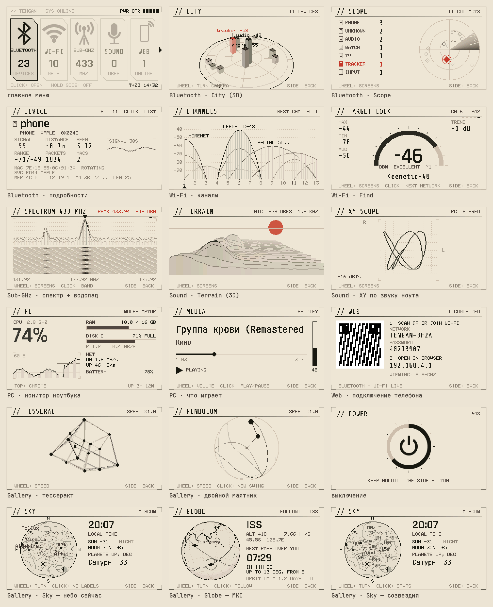
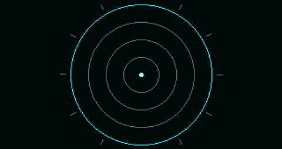
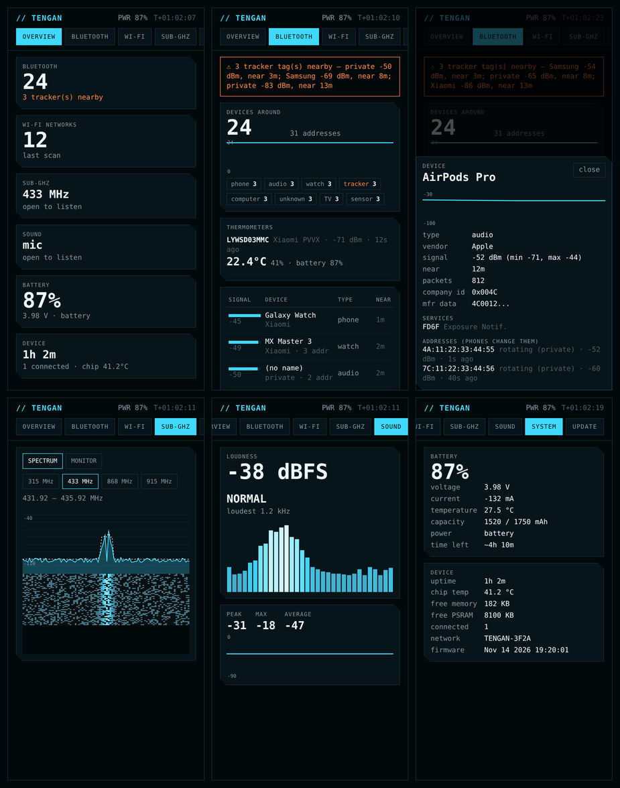
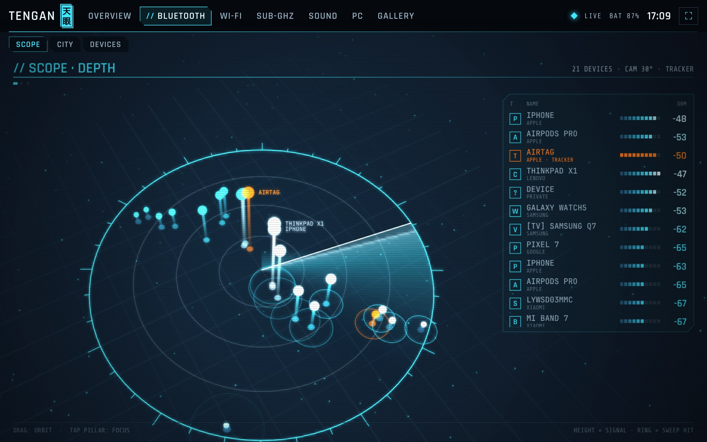
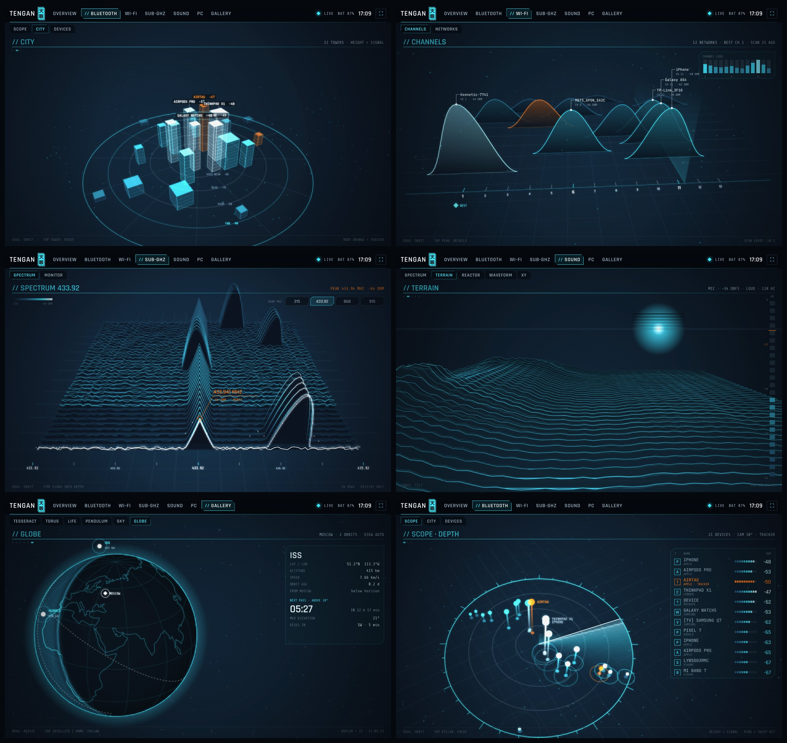
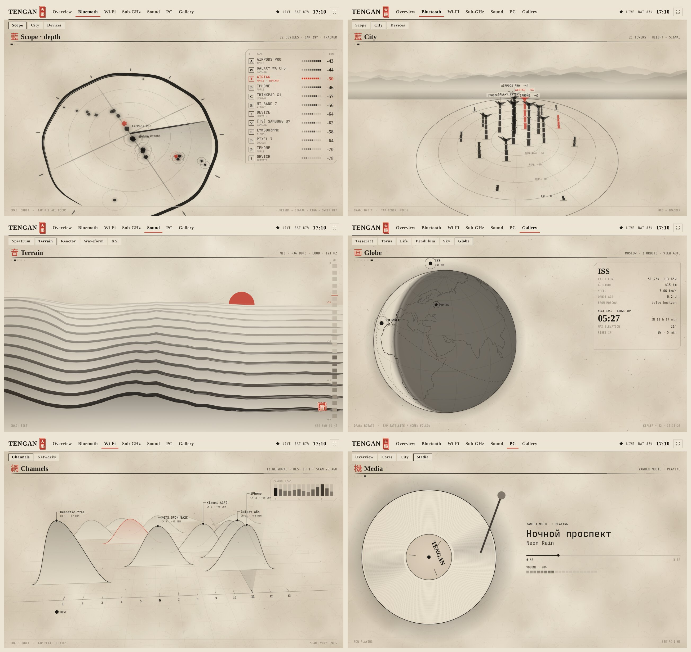

<div align="center">


# TENGAN 天眼

**Карманный анализатор радиоэфира для LilyGO T-Embed CC1101**

Bluetooth · Wi-Fi · Sub-GHz · звук · монитор ноутбука · 3D и красивое — в одном «тактическом» интерфейсе.<br>
**Только слушает.** Ничего не передаёт, ни к чему не подключается.

[](https://github.com/wolfyboy1488/lilygostuff/actions/workflows/build.yml)


[**Скачать**](https://github.com/wolfyboy1488/lilygostuff/releases/latest) ·
[Быстрый старт](#-быстрый-старт) ·
[Разделы](#-разделы) ·
[Ноутбук](#-pc--монитор-ноутбука-и-пульт-музыки) ·
[Телефон](#-web--страница-на-телефоне) ·
[Сборка](#-для-разработчиков)

</div>

---

> **天眼 (тэнган)** — по-японски «небесное око». В буддизме так называют взгляд,
> которому видно скрытое и далёкое. Эта палка видит то, чего не видно глазам:
> радиоэфир вокруг — телефоны, наушники, роутеры, брелоки, датчики.

## ✨ Что умеет

| | Раздел | В двух словах |
|:-:|---|---|
| 📶 | **Bluetooth** | сколько устройств вокруг и кто это: телефоны, наушники, часы, **метки-трекеры**; радар, 3D-город, термометры |
| 🛜 | **Wi-Fi** | сети вокруг, загрузка каналов, активность, «горячо-холодно» для поиска хорошего сигнала |
| 📻 | **Sub-GHz** | эфир 315 / 433 / 868 / 915 МГц: спектр, водопад, ловля брелоков и датчиков |
| 🎙 | **Sound** | спектр, 3D-горы, осциллограф — по микрофону палки **или по звуку, который играет на ноутбуке** |
| 📱 | **Web** | палка раздаёт свой Wi-Fi и показывает всё на телефоне; там же — обновление по воздуху |
| 💻 | **PC** | нагрузка ноутбука по USB: CPU, RAM, диск, сеть; **что сейчас играет** и колесо громкости |
| 🌀 | **Gallery** | 4D-гиперкуб, тор, «Жизнь», маятник, **планетарий** и **МКС над тобой** |
| ⚙️ | **Settings** | общие настройки и отдельно для каждого раздела |

<div align="center">

<br><sub>Экран палки 320×170, увеличен ровно вдвое — по пикселю. Все картинки — настоящий код рисования, снятый в симуляторе.</sub>
</div>

<details>
<summary><b>Те же экраны в теме SUMI 墨 (тушь на бумаге)</b></summary>
<br>

</details>

## 🚀 Быстрый старт

<table>
<tr>
<td width="55%">

1. Скачай **`flash_tengan.html`** со страницы
   [**Releases**](https://github.com/wolfyboy1488/lilygostuff/releases/latest).
2. Подключи палку USB-кабелем и открой файл двойным кликом
   (нужен **Chrome** или **Edge** на компьютере).
3. Нажми **«Прошить палку»**, выбери в списке *USB JTAG/serial debug unit*.
4. Когда появится **«Готово»** — выдерни кабель и вставь обратно.

Всё. Прошивка уже внутри файла: ни адресов, ни выбора файлов.
Настройки палки при перепрошивке **сохраняются**.

> Дальше можно обновляться и **без провода** — с телефона:
> раздел Web → страница → вкладка **Update**.

</td>
<td width="45%"></td>
</tr>
</table>

## 🕹 Управление

| | Что делает — везде одинаково |
|---|---|
| **Колесо** | листать экраны раздела · выбирать строку · менять значение |
| **Нажатие колеса** | главное действие экрана (подробности, частота, пауза…) — подписано внизу экрана |
| **Боковая кнопка** | всегда **назад**: подробности → экран → подменю → главное меню |
| **Боковая, держать 2 с** | выключить · включить — держать ~1 с |

Точки под шапкой справа показывают, на каком ты экране раздела.
Каждый раздел работает, **только пока он открыт**: в главном меню радио, микрофон и CC1101 выключены.

<div align="center">

<br><sub>Выключение — как у старого телевизора.</sub>
</div>

## 📡 Разделы

### 📶 Bluetooth

<div align="center"></div>

| Экран | Что показывает |
|---|---|
| **Overview** | сколько устройств рядом (крупно), тренд за 2 минуты, из кого состоит толпа |
| **Scope** | радар: расстояние по силе сигнала, цели окрашены «жаром», метки — оранжевые |
| **City** | 3D: устройства — башни на площадке; ближе — выше и ближе к центру; колесо крутит камеру |
| **Nearest** | ближайшее устройство на дуге-шкале, оценка расстояния, щелчки «ближе-дальше» |
| **Devices** | список; нажатие — **подробности**: все адреса, сервисы, производитель, график сигнала |
| **Weather** | BLE-термометры: Xiaomi (PVVX/ATC), BTHome, Govee, Qingping, SwitchBot, Ruuvi |

<details>
<summary><b>Как палка понимает, что это за устройство</b></summary>

- **Тип** (phone, computer, audio, watch, TV, tracker, beacon, input, sensor) — по тому, что устройство
  само рассылает: имя, «внешний вид» (Appearance), сервисы, типы сообщений Apple (AirPods, AirTag, iPhone…).
- **Производитель** — встроена официальная база Bluetooth: ~4000 компаний и ~700 «фирменных» сервисов.
  У крупных брендов (Apple, Samsung, Google, Xiaomi, Huawei, Sony, JBL, Garmin…) свой цвет.
- **Без двойников.** Телефоны меняют случайный адрес; если адрес замолчал, а сразу появился новый
  с тем же «почерком» и похожей силой сигнала — они склеиваются в одно устройство.
- **Дальность** — Settings → Bluetooth → Range: от `all` до `very near` (−60 dBm). В людном месте
  поставь `room`, чтобы видеть только тех, кто рядом.

</details>

### 🛜 Wi-Fi

| Экран | Что показывает |
|---|---|
| **Networks** | сети (сильные сверху): канал, защита, метки `OPEN` / `PHONE` / `WI-FI6`; нажатие — подробности и **производитель роутера** (~39 000 в базе) |
| **Channels** | каждая сеть — «холмик» реальной ширины на своём канале; какой из 1 / 6 / 11 свободнее |
| **Activity** | пакетов в секунду на каждом канале и шум эфира (например, от микроволновки) |
| **Clients** | сколько устройств в каждой сети и сколько вокруг **ищут Wi-Fi** — только счёт |
| **Find** | «горячо-холодно»: сила сигнала выбранной сети крупно, щелчки — найти, где Wi-Fi лучше |

<sub>ESP32-S3 видит только 2.4 ГГц. Скан пассивный, содержимое пакетов не читается — только заголовки для счёта.</sub>

### 📻 Sub-GHz (CC1101)

| Экран | Что показывает |
|---|---|
| **Spectrum** | развёртка ±2 МГц вокруг 315 / 433 / 868 / 915 МГц + **водопад** — история эфира |
| **Monitor** | слушает одну частоту и ловит **всплески**: брелоки машин и шлагбаумов, звонки, датчики |

<sub>Модуль никогда не переводится в передачу — палка только меряет силу сигнала. Нажатие колеса — следующая полоса.</sub>

### 🎙 Sound

| Экран | Что показывает |
|---|---|
| **Bars** | спектр 32 полосы с «шапками» пиков и отражением |
| **Terrain** | 3D «звуковые горы»: каждый кадр — новый хребет, старые уплывают к горизонту |
| **Reactor** | кольцо из 64 лучей пульсирует и «раскаляется» в такт |
| **Level** | шумомер: громкость, QUIET → VERY LOUD, пик, максимум, график за минуту |
| **Scope** | осциллограф: форма волны |
| **XY** | осциллограф X-Y: левый канал — по горизонтали, правый — по вертикали (фигуры Лиссажу) |

**Источник звука** — Settings → Sound → **Source**: `auto` / `mic` / `laptop`.
Если палка подключена к ноутбуку и запущена [программа](#-pc--монитор-ноутбука-и-пульт-музыки),
все экраны рисуются по **звуку, который играет на ноуте** — чисто, без микрофона. В шапке — метка `PC`.

### 🌀 Gallery

<div align="center"></div>

Красивое само по себе. Колесо — скорость.
**Tesseract** — четырёхмерный куб, «выворачивающийся» сам через себя ·
**Torus** — бублик из ~1000 точек со светом и тенью ·
**Life** — игра Конвея с послесвечением (нажатие — новый мир) ·
**Pendulum** — двойной маятник, честная физика и хаос (нажатие — новый запуск).

**Sky — планетарий.** Небо над твоим городом прямо сейчас: купол (зенит в центре, север сверху),
~1600 звёзд, линии созвездий, Солнце, Луна с фазой и планеты — всё считается на палке. Колесо крутит
купол, нажатие — подписи (созвездия → яркие звёзды → без подписей). Справа — время, Солнце, Луна,
какие планеты сейчас над горизонтом.

**Globe — МКС и спутники.** Вращающаяся Земля с материками, днём и ночью; МКС, станция «Тяньгун» и
«Хаббл» на настоящих орбитах, след полёта, зона, откуда спутник виден, и **ближайший пролёт над твоим
городом**: во сколько, как высоко и с какой стороны смотреть. Колесо крутит Землю, нажатие — следить
за МКС / за домом / за другим спутником.

<sub>Город — Settings › General › City. Точное время палка берёт с ноутбука (программа `pc_monitor`)
и помнит его во встроенных часах; орбиты ноутбук скачивает с CelesTrak раз в 6 часов и передаёт палке —
она их запоминает и дальше считает сама.</sub>

## 📱 Web — страница на телефоне

<table>
<tr>
<td width="45%">

1. На палке открой **Web** — на экране QR-код, сеть `TENGAN-XXXX` и пароль.
2. Наведи камеру телефона на QR — страница откроется сама
   (или открой `192.168.4.1`). С ноутбука — так же.

**Вкладки:** Overview · Bluetooth (с подробностями по нажатию) · Wi-Fi ·
Sub-GHz (спектр, водопад, журнал) · Sound · System (батарея, память, чип) ·
**Update** — прошивка по воздуху.

Работает только то, что нужно открытой вкладке — так страница обновляется быстрее.
Пока телефон подключён к палке, интернета через Wi-Fi у него нет.

**Планшет и ноутбук:** та же сеть палки, в браузере — **`192.168.4.1`**: шкала запуска, заставка,
выбор **LITE** (эта лёгкая страница) или **FULL** (полная сцена, ниже). Сразу в полную — `192.168.4.1/full`.

<details>
<summary><b>Обновление по Wi-Fi и откат</b></summary>

Вкладка **Update** принимает и `tengan_full_0x0.bin`, и `tengan_firmware_ota.bin`.
Новая прошивка пишется во второй слот и считается «пробной»: если она не проработает
15 секунд (зависла, перезагрузилась), загрузчик **сам вернёт старую**.

</details>

</td>
<td width="55%"></td>
</tr>
</table>

## 🖥 FULL — полная сцена на планшете

<div align="center">

</div>

Все разделы палки в полном разрешении планшета: объёмный радар (столбы света — сила сигнала), 3D-город
с кольцами дальности, хребты Wi-Fi, водопад Sub-GHz в глубину, звуковой рельеф, монитор ноутбука,
галерея с небом и глобусом (их считает сам планшет). Палка шлёт только числа (поток на порту 81), всё рисует планшет —
60 кадров, без интернета. Последние три раздела живут в памяти: возвращаешься — сцена уже на месте.



<<<<<<< HEAD
**Приложение для Android** (`tengan_tablet.apk` в релизах): та же сцена, плюс **GPS** — небо и глобус
считаются по твоим координатам, а палка получает их и выбирает город «GPS». Экран не гаснет, без системных панелей.
=======
**Приложение для Android** (`tengan_tablet.apk` в релизах): та же сцена, плюс **GPS** — небо и глобус
считаются по твоим координатам, а палка получает их как город «GPS». Экран не гаснет, без системных панелей.
Поставить: скопировать APK на планшет, открыть, разрешить установку; иконка — печать 天眼.
>>>>>>> origin/main

## 🎨 Темы — DENKO 電光 и SUMI 墨

**Settings → General → Theme.** Палка, планшет и телефонная страница переключаются вместе.



**SUMI 墨 — «тушь»:** рисовая бумага, тушь и киноварь. Радар — энсо и капли туши, город — бамбук в тумане,
звук — горы сансуй с красным солнцем, запуск — мазок кистью между печатями 天 и 眼.

## 💻 PC — монитор ноутбука и пульт музыки

Палка по USB-кабелю становится маленьким экраном для ноутбука:

- **Обзор** — CPU крупно и график за минуту, RAM, диск, сеть, батарея ноута, самый «прожорливый» процесс;
- **Cores** — загрузка каждого ядра;
- **Process City** — 3D-город программ: высота башни — процессор, ширина — память, белая крыша —
  активное окно, оранжевая — ест больше 50%; камера облетает город, нажатие — прожектор на следующую башню;
- **Media** — **что сейчас играет** (название бегущей строкой, исполнитель, приложение, прогресс),
  **колесо крутит громкость**, нажатие — пауза. Русские названия — как есть. Если ничего не играет — крутится пластинка.
- **Звук ноута** для раздела Sound — см. выше.

**Как поставить (Windows):**

1. Нужен [Python](https://www.python.org/downloads/) — при установке поставь галочку **«Add python.exe to PATH»**.
2. Скачай **`pc_monitor_windows.zip`** из [Releases](https://github.com/wolfyboy1488/lilygostuff/releases/latest),
   распакуй (правой кнопкой → «Извлечь всё…»).
3. Подключи палку к ноутбуку и дважды щёлкни **`start_pc_monitor.bat`**.
   В первый раз он сам поставит нужные библиотеки (около минуты).
4. На палке открой раздел **PC**.

Чёрное окно пишет по-русски, что происходит: нашла ли палку, что играет, слушает ли звук.
Закрыл окно — программа выключилась.

<details>
<summary><b>Что и как ставит запускалка, и почему названия трека может не быть</b></summary>

- Обязательные библиотеки: `psutil` (показатели), `pyserial` (USB).
- По желанию: `pycaw` (громкость в %), `winrt-*` (что играет), `numpy` + `PyAudioWPatch` (звук ноутбука).
  Если какая-то не встала — остальное работает.
- Название трека берётся из системной панели Windows «Сейчас воспроизводится». Не все сайты сообщают
  туда трек (например, сайт Яндекс Музыки — нет, а приложение — да). Запасной способ — заголовок окна
  (Spotify, вкладка YouTube).
- Пока программа запущена, она занимает USB-порт палки — **перед прошивкой закрой окно**.

</details>

## 🎨 Дизайн DENKO 電光 — «Tactical HUD»

Как дисплей истребителя или интерфейс из фантастики: почти чёрный фон, тонкие линии, риски и уголки-скобки.

| Цвет | Значит |
|---|---|
| 🟦 бирюзовый | выбор, главное значение, графики |
| ⬜ белый | важные числа |
| ▫️ стальной | подписи и подсказки |
| 🟧 оранжевый | **только тревога**: трекеры, открытые сети, перегрузка, низкий заряд |

Сила сигнала — шкала «жара»: стальной → бирюзовый → белый. Шапка `// НАЗВАНИЕ`, одна сетка на всех экранах.
Шрифты: **Rajdhani** (заголовки и числа), **Share Tech Mono** (текст), **JetBrains Mono** (кириллица).

## ⚠️ Честные ограничения

- **Направление не определить** одной антенной — только «ближе / дальше». Угол на Scope — для красоты.
- **Метры — грубая оценка** по силе сигнала: стены и тело сбивают её в разы.
- **Многие устройства остаются `unknown`** — современные телефоны специально сообщают о себе минимум.
- **Wi-Fi — только 2.4 ГГц**, сети 5 ГГц палке не видны.

## 🛠 Для разработчиков

<details>
<summary><b>Сборка</b></summary>

Нужен [PlatformIO](https://platformio.org/):

```bash
pio run
```

Board-профиль — `boards/T_Embed_PN532.json` (из репозитория LilyGO): `qio_opi`, PSRAM, flash QIO 80 МГц,
вариант `esp32s3` (не `adafruit_feather_esp32s3`: тот до старта программы включает GPIO21 — подсветку экрана).

Общий образ для прошивки на `0x0`:

```bash
esptool --chip esp32s3 merge-bin -o tengan_full_0x0.bin 0x0 bootloader.bin 0x8000 partitions.bin 0xe000 boot_app0.bin 0x10000 firmware.bin
```

Прошивальщик в одном файле: `python tools/flasher/make_flasher.py tengan_full_0x0.bin flash_tengan.html v1.x`.

</details>

<details>
<summary><b>Автосборка и релизы</b></summary>

`.github/workflows/build.yml` собирает прошивку на каждый пуш (файлы — во вкладке Actions → Artifacts).
Релиз: **Actions → build → Run workflow**, в поле `release_tag` вписать версию (например `v1.3`) —
GitHub соберёт прошивальщик, оба `.bin`, программу для ноутбука и выложит их на страницу релиза.

</details>

<details>
<summary><b>Симулятор экрана</b></summary>

`tools/sim/build.sh` собирает настоящий код рисования на компьютере с правдоподобными данными и сохраняет
все экраны в `tools/sim/out/` (и общий лист `contact.png`). `SIM_ANIM=1` — ещё и кадры анимаций;
`python3 tools/make_docs.py` делает из них картинки для этого README.

</details>

<details>
<summary><b>Структура проекта</b></summary>

```
src/main.cpp              запуск и главный цикл
src/core/                 общее: меню, экран, тема, кнопки, питание, батарея, настройки, светодиоды
  board.h                 распиновка и DEVICE_NAME
  section.h               что должен уметь «раздел» меню (одна таблица функций)
  boot.* / seal.h         анимация включения и печать 天眼
  power_screens.cpp       «держи кнопку» и анимация выключения
  timeutil.h psram.h jsonutil.h   мелкие общие помощники
src/ble/                  Bluetooth (ble_core, экраны, ble_city — 3D, базы производителей)
src/wifi/                 Wi-Fi (скан, приём пакетов, экраны, база OUI)
src/subghz/               Sub-GHz: драйвер CC1101 (только приём), спектр, монитор
src/audio/                микрофон (БПФ), динамик, звук ноутбука, экраны Sound
src/web/                  точка Wi-Fi, веб-страница, API, OTA
src/pc/                   монитор ноутбука по USB, Media
src/gallery/              тессеракт, тор, «Жизнь», маятник
tools/pc_monitor/         программа для ноутбука (Python) + bat-запускалка
tools/flasher/            прошивальщик в одном HTML (внутри esptool-js)
tools/webapp/             приложение для планшета: src/ (HTML, CSS, JS) -> build.py -> src/web/tablet_page.h
tools/sim/                симулятор экрана
tools/gen_*.py            генераторы баз, шрифтов и печати
```

Новый раздел меню = папка с таблицей `Section` (см. `core/section.h`) и одна строчка в `core/menu.cpp`.

</details>

## 📜 Лицензии и спасибо

Код проекта — **MIT** (`LICENSE`).

- Шрифты: **Share Tech Mono** © Carrois Type Design, **Rajdhani** © Indian Type Foundry — SIL OFL 1.1;
  **JetBrains Mono** © JetBrains — Apache 2.0; печать 天眼 отрисована шрифтом **IPAGothic** (IPA Font License).
- Прошивальщик: [**esptool-js**](https://github.com/espressif/esptool-js) © Espressif — Apache 2.0 (внутри — pako, MIT).
- Библиотеки: TFT_eSPI, NimBLE-Arduino, Adafruit NeoPixel, ESP-IDF / Arduino-ESP32.
- Базы: Bluetooth SIG (Company ID, member UUID), IEEE OUI.
- Небо и Земля: [d3-celestial](https://github.com/ofrohn/d3-celestial) © Olaf Frohn — BSD-3 (каталог Hipparcos,
  созвездия); [world-atlas](https://github.com/topojson/world-atlas) © Mike Bostock — ISC (Natural Earth);
  орбиты — [CelesTrak](https://celestrak.org); планеты — элементы орбит JPL (E. M. Standish).

<div align="center">
<br>
<sub>Хобби-проект. Всё, что показывает палка, устройства и так рассылают в эфир всем вокруг.</sub>
<br><br>
<b>// TENGAN 天眼</b>
</div>
