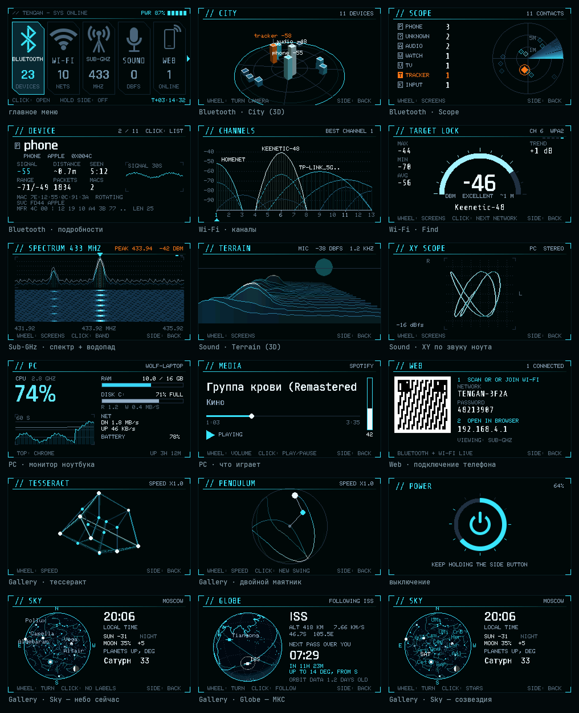

# Radio Radar — T-Embed CC1101

Самодельная прошивка для **LilyGO T-Embed CC1101 (Plus)** (ESP32-S3): карманный
анализатор радиоэфира в стиле «тактического» интерфейса. Bluetooth, Wi-Fi 2.4 ГГц
и Sub-GHz (CC1101) — **только приём**: палка слушает эфир, считает и рисует,
ни к чему не подключается и ничего не передаёт.

> Хобби-проект. Всё, что показывает палка, устройства и так рассылают в эфир
> всем вокруг (реклама Bluetooth, маячки Wi-Fi, сигналы брелоков).



## Дизайн-система «Tactical HUD»

Принципы (из авиационных стандартов индикации, приборных интерфейсов и FUI):

- **Иерархия.** На каждом экране одно главное число — крупно; вторичное — мельче
  и тише; служебное — по краям. Пустые экраны объясняют, чего ждать.
- **Цвет = смысл, и только один.** Бирюзовый — выбор и главное значение, почти
  белый — значения, стальной — подписи, тусклый — подсказки.
  **Оранжевый — только тревога** (метки вроде AirTag, открытые сети и WEP,
  шумный канал, низкий заряд). Сила сигнала — шкала «жара»: стальной →
  бирюзовый → белый.
- **Не только цвет.** Категории дублируются значками-буквами, тревога —
  инверсией (тёмная буква на светлом) и восклицательным знаком.
- **Одна сетка.** Шапка `// НАЗВАНИЕ` + статус справа (0–19 px), контент с
  полями 8 px, подвал с подсказками управления. Уголки-скобки по краям экрана.
- **Шрифты:** Rajdhani — заголовки и крупные числа, Share Tech Mono — текст,
  пиксельный 6×8 — подписи ЗАГЛАВНЫМИ.
- **Стабильная навигация.** Главное меню → подменю раздела → экран →
  подробности; боковая кнопка всегда «на шаг назад».

Шрифты: Share Tech Mono © Carrois Type Design и Rajdhani © Indian Type Foundry,
оба — SIL Open Font License 1.1 (`fonts/OFL.txt`, `fonts/OFL-Rajdhani.txt`).

## Главное меню

Пять скошенных панелей — **Bluetooth**, **Wi-Fi**, **Sub-GHz**, **Sound**, **Settings** — с
иконкой и живым значением. Сверху статус и заряд батареи сегментами, снизу
время работы. При включении — заставка-самопроверка.

## Bluetooth

1. **Overview** — сколько устройств вокруг (крупно), изменение за 2 минуты,
   график за 2.5 минуты (▼ — пришла группа), из чего состоит толпа: полоса долей
   и значки типов с числами.
2. **Scope** — радар: расстояние по силе сигнала (угол условный — пеленг одной
   антенной невозможен), цели-ромбы окрашены «жаром», метки — оранжевые;
   слева — сколько каких типов.
3. **City** — 3D: устройства стоят башнями на круглой площадке. Ближе — ближе
   к центру и выше; цвет — сила сигнала, метки оранжевые; подписаны три ближайших.
   Данные обновляются раз в 1.5 с и плавно перетекают; камера облетает площадку,
   колесо поворачивает её.
4. **Nearest** — ближайшее устройство на дуге-шкале: dBm, оценка расстояния,
   кто это. Метка — оранжевым с «! TRACKER».
5. **Devices** — список (ближние сверху, порядок «липкий»): значок типа, имя,
   производитель, сила. Нажатие — **подробности**: показатели, график сигнала
   за 30 с, MAC и вид адреса, сервисы, данные производителя.
6. **Weather** — температура, влажность (давление / CO₂) от BLE-термометров:
   Xiaomi с прошивкой PVVX или ATC, BTHome (без шифрования), Govee, Qingping,
   SwitchBot Meter, RuuviTag, старые Xiaomi без шифрования.

## Wi-Fi

ESP32-S3 работает только в 2.4 ГГц — сети 5 ГГц не видны. Только приём:
скан пассивный, содержимое пакетов не читается — только заголовки для счёта.

1. **NETWORKS** — сети вокруг (сильные сверху, порядок «липкий»): имя, канал,
   сила сигнала; значок слева — защита (O открытая и ! WEP — оранжевые, 1/2/3 —
   WPA/WPA2/WPA3, E — корпоративная). Метки: `OPEN`, `PHONE` (раздача с
   телефона), `WI-FI6`.
   Нажатие колеса — подробности: защита, канал, ширина (20/40 МГц),
   поколение, сила сейчас / мин / макс, сколько видна, сколько сетей мешает
   на том же и соседних каналах, сколько устройств в сети, график сигнала,
   **производитель роутера** (база ~39 000 производителей IEEE) и BSSID.
2. **CHANNELS** — загрузка каналов: каждая сеть — «холмик» своей реальной
   ширины (20 или 40 МГц), высота и «жар» = сила сигнала. Справа вверху и
   треугольником под осью — какой из каналов 1 / 6 / 11 сейчас свободнее.
3. **ACTIVITY** — сколько Wi-Fi-пакетов в секунду на каждом канале (палка по
   очереди слушает каналы 1–13): ярко — данные, тускло — маячки и
   служебные. Под столбиками — **шум** канала в dBm (обычно 90–95; число
   меньше и оранжевое — канал зашумлён, например микроволновкой).
   Внизу — общий трафик за 2 минуты, светодиоды — уровень трафика.
4. **CLIENTS** — сколько устройств работает в каждой сети (по тому, кто кому
   шлёт данные) и сколько устройств вокруг **ищут Wi-Fi**. Только счёт:
   адреса хранятся в памяти 2 минуты и никуда не выводятся. Телефоны меняют
   адреса, поэтому число «ищущих» — примерное.
5. **FIND** — «горячо-холодно» для Wi-Fi: крупно сила сигнала выбранной сети
   (выбери её в NETWORKS; нажатие колеса — следующая сеть), оценка
   excellent / good / fair / weak / bad, дуга-шкала, MAX / MIN / AVG,
   «теплее / холоднее», светодиоды. Палка
   слушает только канал этой сети, поэтому обновляется в разы быстрее.
   Помогает найти, где дома Wi-Fi хороший, а где плохой.

## Sub-GHz (CC1101)

**Только приём**: модуль никогда не переводится в передачу, палка лишь меряет
силу сигнала. Полосы: 315 / 433 / 868 / 915 МГц (нажатие колеса — следующая
полоса; антенна переключается автоматически).

1. **Spectrum** — развёртка ±2 МГц вокруг выбранной полосы: яркая линия —
   сейчас («жар» по силе), тусклая — пики, маркер — самый сильный сигнал
   (частота и dBm в шапке). Ниже — «водопад»: история, новые строки сверху, цвет = сила.
2. **Monitor** — слушает одну частоту (315.00 / 433.92 / 868.30 / 915.00) и
   ловит **всплески**: нажатия брелоков машин, шлагбаумов и ворот, звонков,
   передачи датчиков. Лента сигнала за ~6 с, уровень шума, журнал последних
   всплесков (когда, сколько длился, насколько сильный), вспышка светодиодов.

CC1101 делит линии SPI с экраном; драйвер перед каждым обменом включает
режим чтения шины, а экран возвращает своё при отрисовке.

## Sound (микрофон и динамик)

Раздел работает с цифровым микрофоном (PDM): палка слушает, считает громкость
и спектр (БПФ, 32 полосы 60 Гц – 8 кГц) — **ничего не записывает**; микрофон
включён, только пока открыт раздел. Так же и остальные разделы: Bluetooth,
Wi-Fi и Sub-GHz работают только пока вы внутри них, в главном меню всё выключено.

1. **Bars** — спектр звука: сегментные столбики, «шапки» пиков, отражение,
   громкость и самая громкая частота в шапке.
2. **Terrain** — 3D «звуковые горы»: каждый кадр спектр становится новым
   хребтом спереди, старые уплывают к горизонту; басы слева, высокие справа.
   Хребет сглажен и нормирован сам на себя — громкий звук не превращает всё в стену.
3. **Reactor** — анимация: кольцо из 64 лучей пульсирует, вращается и
   «раскаляется» в такт звуку; орбиты, вращающаяся шкала.
4. **Level** — шумомер: громкость в dBFS крупно (0 — предел микрофона),
   QUIET / NORMAL / LOUD / VERY LOUD, шкала с пиком, PEAK / MAX / AVG и
   график за минуту. Громче −25 dBFS — оранжевым. Нажатие — сброс.
5. **Scope** — осциллограф: форма волны с «запуском» по нулю и автоусилением.

Светодиоды могут показывать громкость — Settings → Sound → LED meter
(по умолчанию выключено).

**Динамик:** тихие щелчки колеса и «счётчик Гейгера» на экранах поиска
(Wi-Fi Find, Bluetooth Nearest): чем ближе цель, тем чаще щелчки.
Громкость — Settings → General → Volume; щелчки поиска отключаются в
настройках Bluetooth / Wi-Fi.

## Web

Палка раздаёт свою сеть Wi-Fi и показывает страницу с данными на телефоне
или компьютере (никаких программ ставить не нужно — палка сама сервер).
1. Открыть раздел **Web**: на экране QR-код, имя сети `RadioRadar-XXXX` и пароль
   (8 цифр, одинаковые каждый раз).
2. Навести камеру телефона на QR (или подключиться вручную), страница откроется
   сама; если нет — открыть в браузере `192.168.4.1`.

Меню страницы (каждая вкладка спрашивает у палки только свои данные):
- **Overview** — главное одним экраном: устройства, сети, батарея, время работы.
- **Bluetooth** — число и график, типы, термометры, предупреждение о метках-трекерах,
  таблица (сортировка по заголовку); нажатие на строку — подробности: все адреса
  устройства, сервисы, данные производителя, график сигнала.
- **Wi-Fi** — сети вокруг (скан раз в 20 с), каналы на графике, лучший канал.
- **Sub-GHz** — спектр + водопад или монитор с журналом пойманных сигналов;
  выбор полосы 315/433/868/915. CC1101 включается, только пока вкладка открыта.
- **Sound** — громкость, спектр, пик/максимум/среднее, график громкости
  (если микрофон разрешён в настройках). Микрофон работает, только пока вкладка открыта.
- **System** — батарея (напряжение, ток, температура, ёмкость, время до разряда),
  время работы, температура чипа, свободная память, версия прошивки.

Пока телефон подключён к палке, интернета через Wi-Fi у него нет; после выхода
из раздела он вернётся к домашней сети. На экране палки видно, какую вкладку смотрят.

Работает только то, что нужно открытой вкладке: Bluetooth — на Overview и Bluetooth,
скан сетей — на Overview и Wi-Fi, CC1101 и микрофон — только на своих вкладках.
Так весь эфир достаётся связи с телефоном, и «живые» вкладки обновляются быстрее.

### Обновление прошивки по Wi-Fi

Вкладка **Update** на странице: выбрать файл прошивки (тот же `.bin`, что шьётся
по USB на 0x0, или `firmware.bin`) и нажать UPLOAD. Палка пишет новую прошивку во
второй слот и перезагружается. Новая прошивка «пробная»: если она не проработала
15 секунд (зависла, перезагрузилась), загрузчик сам вернёт старую. Во время
загрузки на экране палки — прогресс; Bluetooth на это время выключается.

## PC — монитор ноутбука

Палка по USB-кабелю показывает нагрузку ноутбука (Windows; Linux/macOS тоже):
CPU крупно и график за минуту, загрузка ядер (колесо — вторая страница), RAM,
диск C: (заполненность, чтение/запись), сеть (скачивание/отдача), батарея ноута,
время работы и самый «прожорливый» процесс.

На ноуте: распаковать `pc_monitor_windows.zip` (из релиза) и дважды щёлкнуть
`start_pc_monitor.bat`. Нужен Python с python.org (галочка «Add to PATH»); при первом
запуске bat сам поставит библиотеки `psutil` и `pyserial`. Программа сама находит
палку среди USB-устройств, переподключается, если кабель выдернули, и пишет
по-русски, если что-то не так. Пока она запущена, USB-порт палки занят —
перед прошивкой через esptool-js окно нужно закрыть.

Третья страница раздела — **Media** (пульт): колесо крутит громкость ноутбука,
нажатие — пауза/играть, боковая — назад на обзор. Программа на ноуте нажимает
мультимедийные клавиши Windows; если поставилась библиотека `pycaw`, палка показывает
громкость в процентах.

Формат строки (раз в секунду): `PC cpu=23.4 freq=2.80 c=12,40,5 ram=61.2 ramu=9.8 ramt=16.0
dsk=71 dr=1.2 dw=0.3 nd=120 nu=15 up=12345 top=chrome host=LAPTOP bat=87 plug=1`.

## Gallery

Красивые штуки, которые ничего не анализируют. Колесо — скорость, нажатие — назад.
1. **Tesseract** — четырёхмерный гиперкуб: вращается в плоскостях XW, YW, ZW и XY,
   внутренний куб «выворачивается» через внешний; цвет рёбер — глубина в 4D, след.
2. **Torus** — бублик из ~1000 точек с освещением и глубиной.
3. **Life** — игра «Жизнь» Конвея: рождённые клетки белые, старые остывают, умершие
   оставляют след; застой или вымирание — новые фигуры. Нажатие — новый мир.
4. **Pendulum** — двойной маятник (Рунге-Кутта 4): хаотичные качания и светящийся
   след нижнего груза, ярче — где быстрее. Нажатие — новый запуск.

## Батарея

Значок в главном меню и пункт **Battery** в настройках. Только чтение датчиков
BQ27220 и BQ25896 — настройки зарядки не меняются.

## Настройки

Хранятся в памяти платы. В разделе Settings — подменю из страниц:

**General** (общие):
- **Screen**, **LED brightness** — яркость экрана и светодиодов.
- **Auto dim** — приглушать экран, если кнопки не трогали: `off` (по
  умолчанию), 30 с, 1 мин, 5 мин. Первое нажатие только будит экран.
- **Volume** — все звуки: `off` / `quiet` (по умолчанию) / `loud`.
- **Wheel clicks** — щелчок на каждый шаг колеса.
- **Battery** — заряд, напряжение и оценка времени.

**Bluetooth:**
- **Range** — `all`, `far` (−90 dBm), `room` (−80), `near` (−70),
  `very near` (−60). Слабее порога — не считаются; выбывают с запасом 5 dBm.
- **LED events** — на сколько должно скакнуть число устройств, чтобы мигнули
  светодиоды (`off` — не мигать).
- **Find ticks** — щелчки «ближе-дальше» на экране Nearest.

**Wi-Fi:**
- **Range** — скрыть из списка сети слабее порога (те же ступени).
- **Find ticks** — щелчки на экране Find.

**Sub-GHz:** **Start band** — полоса при входе (её же меняет нажатие в разделе).

**Sound:** **Microphone** — `on` / `off`; **LED meter** — светодиоды
показывают громкость (по умолчанию выключено). Если микрофон включён, но звука нет,
раздел показывает экран **Mic check**: состояние драйвера, сколько блоков
пришло, пик сигнала и канал (левый/правый пробуются автоматически).

## Управление

- **Колесо** — в меню и подменю выбирает пункт; на экране листает экраны
  раздела; в списках выбирает строку; в Settings меняет значение.
- **Нажатие колеса** — открыть; в списках — подробности; в Find — следующая
  сеть; в Sub-GHz — следующая полоса; в Settings — следующий пункт.
- **Боковая кнопка, коротко** — на шаг назад (подробности → экран → подменю →
  главное меню).
- **Боковая кнопка, 2 с** — выключить (глубокий сон, периферия обесточена);
  **включить** — держать ~1 с. Колесо питанием не управляет.

## Симулятор экрана

`tools/sim/build.sh` собирает настоящий код рисования на компьютере с
правдоподобными данными и сохраняет все экраны в `tools/sim/out/*.png`
(и общий лист `contact.png`). Так дизайн проверяется без прошивки.

## Тип устройства

Палка пытается понять, *что* это за устройство: phone, computer, audio,
watch, TV, tracker, beacon, input, sensor (или unknown). Подсказки берутся из
того, что устройство само рассылает: имя, «внешний вид» (Appearance), сервисы
(например, метки Tile/SmartTag, датчики Xiaomi), типы сообщений Apple
(AirPods, AirTag, iPhone, Apple TV...). Тип ближайшего устройства виден в
экранах Nearest и Devices. Определение примерное: многие устройства не сообщают о себе
ничего полезного и остаются unknown.

## Производители

В прошивку встроена официальная база Bluetooth: ~4000 производителей
(Company ID) и ~700 «фирменных» сервисов (member UUID). Поэтому палка
подписывает почти любого производителя по имени, а у крупных брендов
(Apple, Samsung, Google, Xiaomi, Huawei, Honor, OnePlus, Oppo, Realme, vivo,
Sony, LG, Amazfit, Garmin, JBL, Bose, Amazon, Meta...) есть свой цвет.
Android-устройства без подписи производителя узнаются по фирменным сервисам
(например, сервисы Google, Samsung, Xiaomi). Если в рекламе указан только
производитель Bluetooth-чипа (Nordic, Espressif, Qualcomm...), а фирменный
сервис бренда тоже есть — побеждает бренд.

Таблицы генерируются скриптом `tools/gen_btdb.py` (источники указаны в нём).

## Счёт без двойников

Телефоны периодически меняют свой случайный адрес, и раньше один телефон
мог считаться за два. Теперь, если адрес замолчал, а сразу после появился
новый с таким же «почерком» рекламы и похожей силой сигнала, они склеиваются
в одно устройство. В RADAR серым в углу показано, сколько было «сырых»
адресов (`N MAC`), если это число отличается. Склейка — тоже оценка: в толпе
одинаковых телефонов она может изредка ошибиться.

## Светодиоды (WS2812, 8 шт.)

В покое погашены, реагируют только на крупные события: при изменении числа
устройств на ±N (по умолчанию 7) — **зелёная волна** (пришла группа) или
**оранжевая вспышка** (ушла). Порог считается от сглаженной базовой линии, с
паузой, чтобы не срабатывать на дрожание из-за рандомизации MAC.

## Честные ограничения (физика, не лень)

- **Направление определить нельзя** одной антенной — только расстояние (по силе
  сигнала). «Угол» целей на Scope — для вида. Реальный пеленг требует антенной
  решётки (BLE AoA).
- **Расстояние в метрах — грубая оценка** по модели затухания сигнала; стены,
  тело и отражения легко сбивают её в разы. Это «порядок величины», не рулетка.
- **Классификация устройств** работает по Company ID из рекламы и ограничена:
  современные телефоны рандомизируют MAC и вещают по минимуму ради приватности,
  поэтому многие остаются в «private». Надёжнее всего определяется вендор
  аксессуаров (наушники, часы, метки).

## Железо

LilyGO T-Embed CC1101 Plus — ESP32-S3 (16 МБ Flash / 8 МБ OPI PSRAM), дисплей
ST7789 170×320, энкодер с кнопкой, боковая кнопка, 8× WS2812, CC1101, nRF24,
PN532 (в этой прошивке задействованы экран, Bluetooth и Wi-Fi ESP32, CC1101,
датчики батареи, энкодер/кнопки и светодиоды).

## Сборка

Нужен [PlatformIO](https://platformio.org/).

```
pio run
```

Board-профиль лежит в `boards/T_Embed_PN532.json` (взят из официального
репозитория LilyGO): `memory_type=qio_opi`, `BOARD_HAS_PSRAM`, flash QIO 80 МГц,
вариант `esp32s3` (не `adafruit_feather_esp32s3`: тот до запуска программы включает
GPIO21 — подсветку экрана).

## Прошивка

Проще всего — браузером, без установки софта:

1. Скачай `radio_radar_full_0x0.bin` со страницы **Releases** репозитория
   (собирает GitHub Actions; сборка любого пуша — во вкладке **Actions**, раздел Artifacts).
   Или собери сам: `pio run`, затем
   ```
   esptool --chip esp32s3 merge-bin -o radio_radar_full_0x0.bin \
     0x0 bootloader.bin 0x8000 partitions.bin 0xe000 boot_app0.bin 0x10000 firmware.bin
   ```
2. Открой [esptool-js](https://espressif.github.io/esptool-js/) в Chrome →
   **Connect** → порт `USB JTAG/serial debug unit`.
3. Flash Address **`0x0`** → выбери `radio_radar_full_0x0.bin` → **Program**.
4. Вынь USB (полный power-cycle) — прошивка стартует. На ESP32-S3 программный
   сброс по USB-JTAG часто не срабатывает, поэтому именно выдёргивание кабеля
   запускает приложение.

Дальше можно обновляться без провода: раздел **Web** → вкладка **Update**
(подходит и `radio_radar_full_0x0.bin`, и `radio_radar_firmware_ota.bin`).

Вернуть заводское/Bruce — просто прошей его поверх по USB.

## Структура

```
src/main.cpp               — запуск и главный цикл (только «склейка» модулей)
src/core/                  — общее для всех разделов
  board.h                  — распиновка платы
  section.h                — что должен уметь «раздел» меню (одна таблица функций)
  menu.*                   — главное меню, подменю, навигация «на шаг назад»
  display.*                — экран, общие элементы (списки, графики, иконки, подменю)
  input.*                  — колесо (на прерываниях) и кнопки
  power.*                  — выключение / включение боковой кнопкой
  battery.*                — батарея (BQ27220 + BQ25896, только чтение)
  settings.*               — настройки и их экран
  theme.*                  — дизайн-система: палитра, шрифты, значки, уголки экрана
  ui.*                     — компоненты: шапка, подвал, рамки, показатели, выделение строки
  boot.*                   — заставка при включении
  fonts/                   — шрифты для экрана (генерируются)
  leds.*                   — светодиодная лента
src/ble/                   — раздел Bluetooth
  ble.h                    — всё, что нужно снаружи раздела
  ble_model.h              — данные раздела (устройства, датчики, история)
  ble_core.cpp             — сканирование, склейка адресов, список, навигация
  ble_screens.cpp          — экраны
  vendors.*                — производители (бренды, цвета)
  devtypes.h               — тип устройства по рекламе
  sensors.h                — показания BLE-термометров
  btdb.h                   — база производителей Bluetooth (генерируется)
src/wifi/                  — раздел Wi-Fi
  wifi.h / wifi_model.*    — снаружи / данные и помощники без железа
  wifi.cpp                 — скан, приём пакетов, подсчёт, навигация
  wifi_screens.cpp         — экраны
  ouidb.h                  — производители сетевых устройств по MAC (генерируется)
src/audio/                 — раздел Sound и звуки интерфейса
  audio.* / audio_model.h  — микрофон (БПФ), динамик, раздел
  audio_screens.cpp        — экраны
src/subghz/                — раздел Sub-GHz
  cc1101.*                 — драйвер CC1101 (только приём)
  subghz.* / subghz_model.h — логика раздела и его данные
  subghz_screens.cpp       — экраны
tools/gen_btdb.py          — генератор btdb.h
tools/gen_ouidb.py         — генератор ouidb.h
tools/gen_gfxfont.py       — TTF -> растровый шрифт для экрана
tools/sim/                 — симулятор экрана на компьютере (build.sh -> out/*.png)
fonts/                     — исходный шрифт и его лицензия
platformio.ini             — конфигурация сборки
boards/T_Embed_PN532.json  — board-профиль LilyGO
```

Новый раздел меню = папка с файлом, где описана таблица `Section`
(см. `core/section.h`), и одна строчка в списке разделов в `core/menu.cpp`.

## Лицензия

MIT (см. `LICENSE`).
