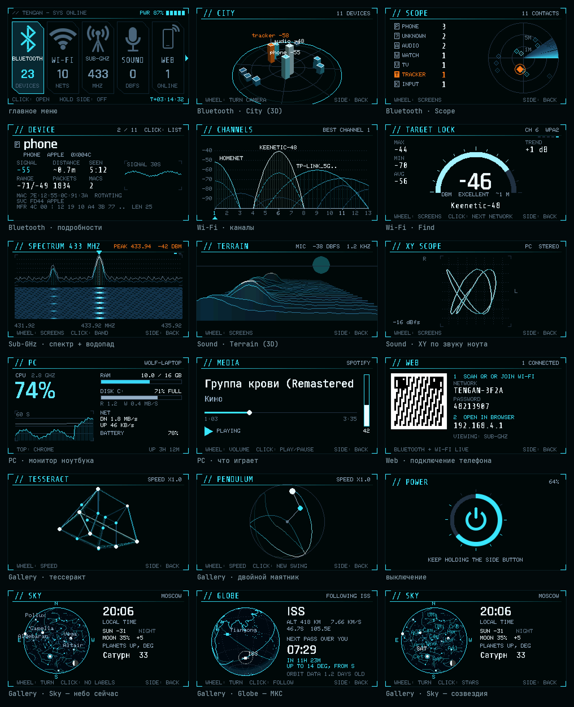
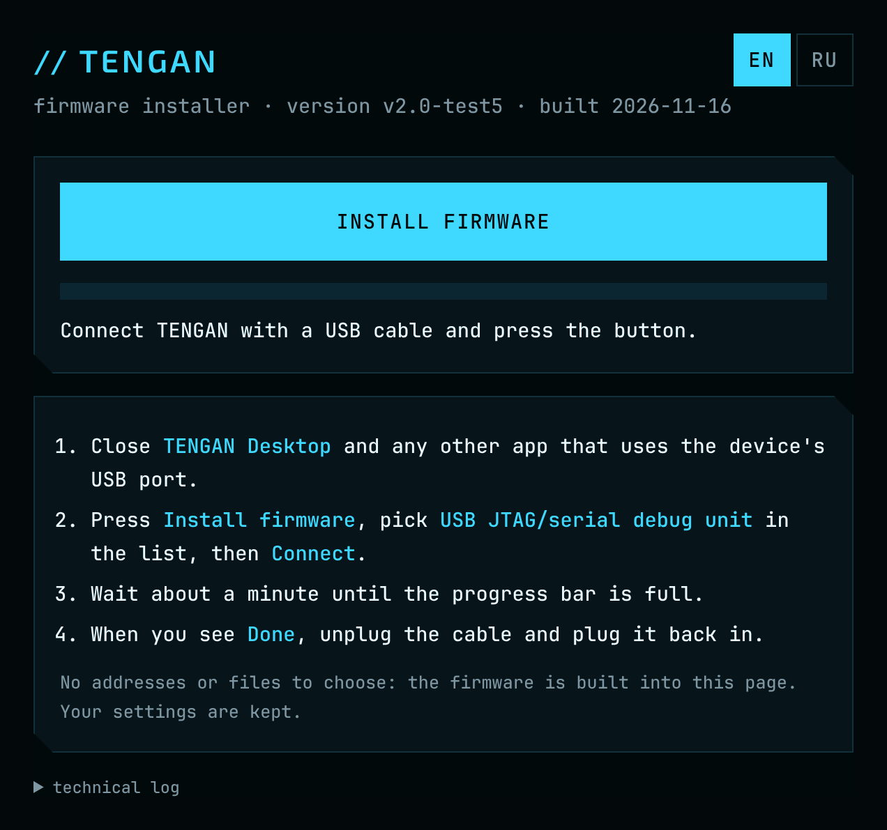
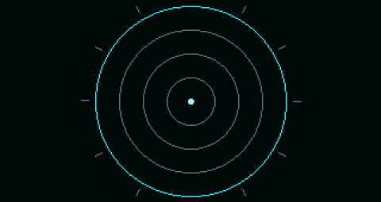
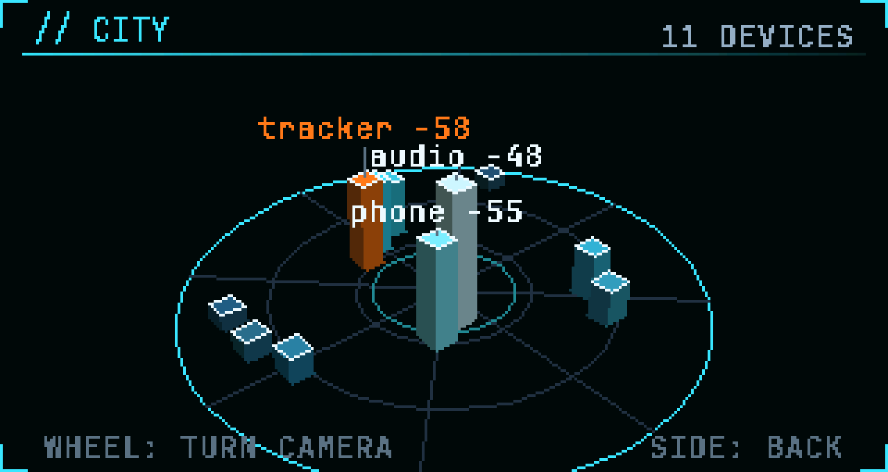
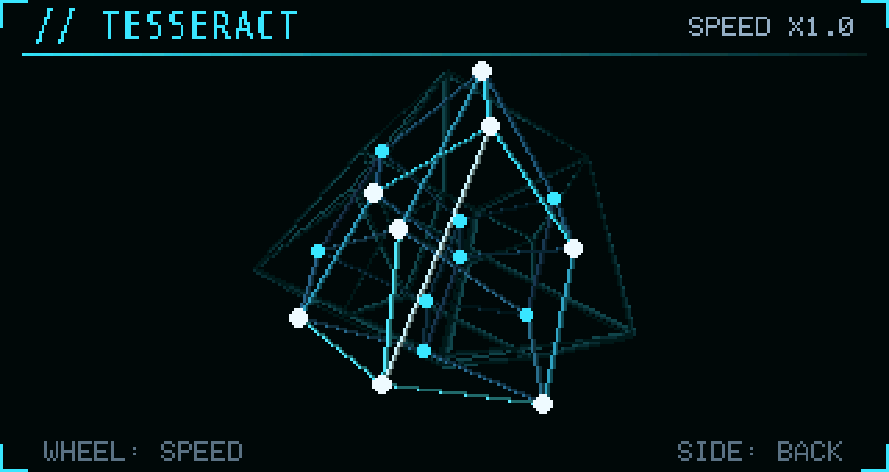
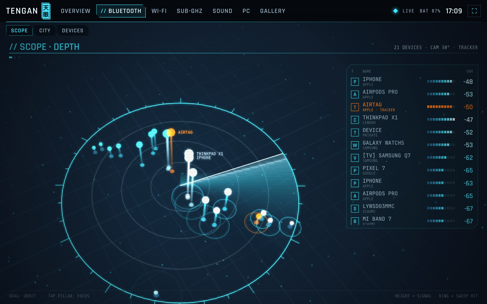
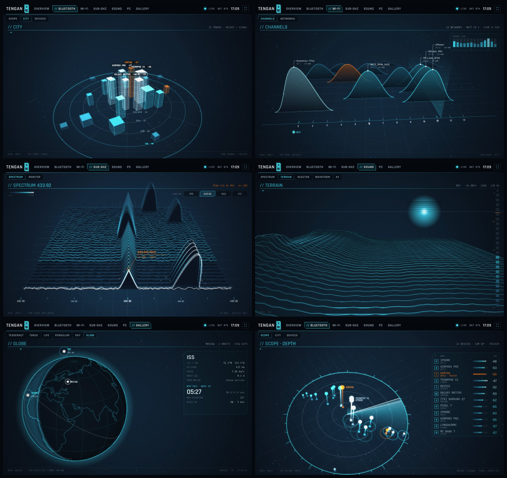
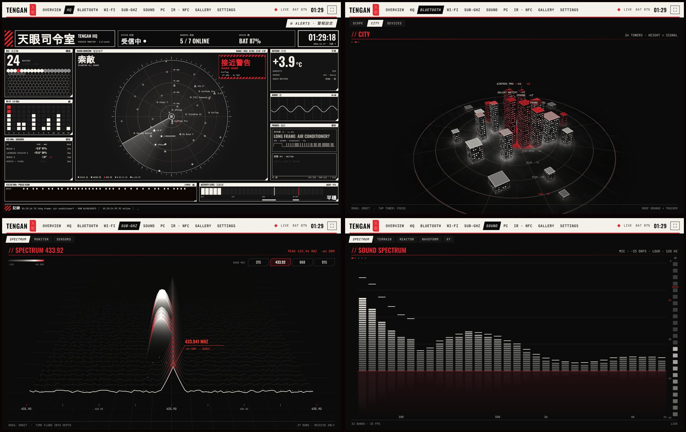
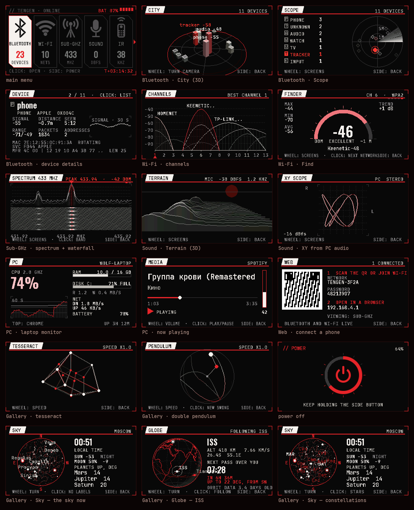

<div align="center">


# TENGAN 天眼

**Карманный анализатор радиоэфира на базе LilyGO T-Embed CC1101 Plus**

Bluetooth · Wi-Fi · Sub-GHz · ИК · NFC · звук · монитор ПК — в одном «тактическом» интерфейсе,<br>
на экране устройства, на планшете (TENGAN Tablet) и на компьютере (TENGAN Desktop).<br>
**Только приём.** TENGAN ничего не передаёт в эфир и ничего не записывает на карты.

[](https://github.com/wolfyboy1488/lilygostuff/actions/workflows/build.yml)


[**Скачать**](https://github.com/wolfyboy1488/lilygostuff/releases/latest) ·
[Быстрый старт](#-быстрый-старт) ·
[Разделы](#-разделы) ·
[Планшет и компьютер](#-tengan-tablet-и-tengan-desktop) ·
[Вопросы](#-вопросы-и-ответы) ·
[Сборка](#-сборка-из-исходников) ·
[**English**](README.md)

</div>

---

> **天眼 (тэнган)** — по-японски «небесное око»: взгляд, которому видно скрытое и далёкое.
> TENGAN показывает то, чего не видно глазам: радиоэфир вокруг — телефоны, наушники, роутеры,
> пульты, брелоки, уличные датчики, карты.

## ✨ Возможности

| | Раздел | Что показывает |
|:-:|---|---|
| 📶 | **Bluetooth** | сколько устройств рядом и кто это: телефоны, наушники, часы, **метки-трекеры**; радар, 3D-город, BLE-термометры |
| 🛜 | **Wi-Fi** | сети вокруг, загрузка каналов, активность эфира, поиск места с лучшим сигналом |
| 📻 | **Sub-GHz** | эфир 315 / 433 / 868 / 915 МГц: спектр, водопад, всплески; **уличные метеодатчики 433 МГц** |
| 🔦 | **ИК · NFC** | «чей пульт?» — протокол, марка, код кнопки; «что за карта?» — тип карты или метки |
| 🎙 | **Звук** | спектр, 3D-рельеф, осциллограф — по микрофону или по звуку компьютера |
| 🛰 | **Штаб** | всё сразу на одном экране: радиогоризонт, тревоги, датчики, звук, пульты и карты |
| 💻 | **ПК** | нагрузка компьютера, **что сейчас играет**, управление громкостью и треками |
| 🌀 | **Галерея** | 4D-гиперкуб, тор, «Жизнь», маятник, **планетарий**, **МКС над тобой**, радиопогода |
| ⚙️ | **Настройки** | общие, по разделам и **тревоги**; одинаковые на устройстве, планшете и компьютере |

<div align="center">

<br><sub>Экран устройства 320×170, увеличен вдвое. Все картинки — настоящий код рисования, снятый в симуляторе.</sub>
</div>

## 🚀 Быстрый старт

<table>
<tr>
<td width="55%">

1. Скачай прошивальщик со страницы [**Releases**](https://github.com/wolfyboy1488/lilygostuff/releases/latest):
   **`flash_tengan_ru.html`** — русская версия, **`flash_tengan_en.html`** — английская.
2. Подключи T-Embed к компьютеру USB-кабелем и открой файл в **Chrome** или **Edge**.
3. Нажми **«Прошить»** и выбери в списке *USB JTAG/serial debug unit*.
4. Когда появится **«Готово»**, переподключи кабель.

Прошивка уже внутри файла — ни адресов, ни выбора файлов. Настройки при перепрошивке **сохраняются**.

> Дальше можно обновляться **без провода**: раздел Web → страница → вкладка **Update**.

</td>
<td width="45%"></td>
</tr>
</table>

**Язык** выбирается версией прошивки: русская или английская. Интерфейс устройства, планшета и программы
на компьютере будет на этом языке.

## 🕹 Управление

| | Действие |
|---|---|
| **Колесо** | листать экраны раздела · выбирать строку · менять значение |
| **Нажатие колеса** | главное действие экрана (подробности, частота, пауза…) — подписано внизу |
| **Боковая кнопка** | назад: подробности → экран → список экранов → главное меню |
| **Боковая, держать 2 с** | выключить · включить — держать ~1 с |

Раздел работает, **только пока он открыт**: в главном меню радио, микрофон и CC1101 выключены — так дольше живёт батарея.

<div align="center">

</div>

## 📡 Разделы

### 📶 Bluetooth

<div align="center"></div>

| Экран | Что показывает |
|---|---|
| **Обзор** | сколько устройств рядом, тренд за 2 минуты, из кого состоит толпа |
| **Радар** | расстояние по силе сигнала; трекеры подсвечены |
| **Город** | 3D: устройства — башни; ближе — выше и ближе к центру |
| **Ближайшее** | ближайшее устройство на шкале, оценка расстояния, щелчки «ближе-дальше» |
| **Устройства** | список; нажатие — подробности: адреса, сервисы, производитель, график сигнала |
| **Погода** | BLE-термометры: Xiaomi (PVVX/ATC), BTHome, Govee, Qingping, SwitchBot, Ruuvi |

<details>
<summary><b>Как TENGAN понимает, что это за устройство</b></summary>

- **Тип** (телефон, компьютер, аудио, часы, ТВ, трекер, маячок, датчик…) — по тому, что устройство само рассылает:
  имя, Appearance, сервисы, сообщения Apple (AirPods, AirTag, iPhone…).
- **Производитель** — встроена база Bluetooth SIG: ~4000 компаний и ~700 фирменных сервисов.
- **Без двойников.** Телефоны меняют случайный адрес; если адрес замолчал и сразу появился новый с тем же
  «почерком» — они склеиваются в одно устройство.
- **Дальность** — Настройки › Bluetooth › Дальность: от «все» до «вплотную» (−60 dBm).
- **Свои устройства** можно подписать («мои AirPods») — на планшете или компьютере.

</details>

### 🛜 Wi-Fi

| Экран | Что показывает |
|---|---|
| **Сети** | сети (сильные сверху): канал, защита, открытые сети; нажатие — подробности и производитель роутера (~39 000 в базе) |
| **Каналы** | каждая сеть — «холм» своей ширины на своём канале: какой из 1 / 6 / 11 свободнее |
| **Активность** | пакетов в секунду на каждом канале и шум эфира |
| **Клиенты** | сколько устройств в каждой сети и сколько вокруг ищут Wi-Fi — только счёт |
| **Поиск** | сила сигнала выбранной сети крупно и щелчки — найти, где Wi-Fi лучше |

<sub>ESP32-S3 видит только 2.4 ГГц. Поиск пассивный: содержимое пакетов не читается, только заголовки для счёта.</sub>

### 📻 Sub-GHz (CC1101)

| Экран | Что показывает |
|---|---|
| **Спектр** | развёртка ±2 МГц вокруг 315 / 433 / 868 / 915 МГц и **водопад** — история эфира |
| **Монитор** | одна частота и **всплески**: брелоки, шлагбаумы, звонки, датчики |
| **Датчики** | уличные термометры 433 МГц (Nexus, Rubicson, LaCrosse, Acurite, Bresser, Fine Offset…) и анализ импульсов последней посылки |

<sub>Модуль никогда не переводится в передачу. У пультов и звонков показывается только «отпечаток», код не сохраняется.</sub>

### 🔦 ИК · NFC

- **ИК — «чей пульт?»**: направь пульт на TENGAN и нажми кнопку. Протокол (NEC, Samsung, Sony, RC5/RC6, LG…),
  вероятная марка, адрес и код кнопки, форма сигнала, история нажатий.
- **NFC — «что за карта?»**: приложи карту или метку. Тип (MIFARE, NTAG, DESFire, FeliCa…), подсказка
  («транспортная карта», «метка»), открытые записи меток. **У банковских карт номер и имя не читаются** —
  только «платёжная ли это карта». UID показан частично.

### 🎙 Звук

Спектр 32 полос, 3D-рельеф, «реактор», шумомер, осциллограф и фигуры X-Y.
**Источник** — Настройки › Звук › Источник: авто / микрофон / ПК. С TENGAN Desktop экраны рисуются по звуку,
который играет на компьютере — чисто, без микрофона.

### 🛰 Штаб

Один экран со всем сразу: радиогоризонт (Bluetooth, Wi-Fi, датчики 433), шкала активности эфира с разбивкой
по источникам, температура на улице, звук, последний пульт и карта, журнал событий. Стиль штаба меняется вместе с темой.

**Тревоги** настраиваются: что считать «рядом», когда новое устройство или трекер поднимает тревогу,
чувствительность, пороги «внимание» и «тревога», какие источники учитывать, мигание и плашка «接近警告».
Те же настройки — в Настройки › Тревоги на устройстве, планшете и компьютере и кнопкой ⚙ прямо на экране штаба.

### 🌀 Галерея

<div align="center"></div>

**Тессеракт**, **тор**, **«Жизнь»** Конвея, **двойной маятник** — красивое само по себе.
**Небо** — планетарий над твоим городом: ~1600 звёзд, созвездия, Солнце, Луна с фазой, планеты.
**Глобус** — МКС, «Тяньгун» и «Хаббл» на настоящих орбитах и ближайший пролёт над тобой.
**Погода** — «радиопогода»: облака из устройств вокруг, дождь из посылок 433 МГц, гроза от громкого звука,
плюс температура с уличного датчика.

<sub>Город — Настройки › Общие › Город (или GPS планшета). Точное время и орбиты приходят от TENGAN Desktop;
устройство их запоминает и дальше считает само, без интернета.</sub>

## 📱 TENGAN Tablet и TENGAN Desktop

<div align="center">

</div>

Все разделы в полном разрешении экрана: объёмный радар, 3D-город, хребты Wi-Fi, водопад Sub-GHz в глубину,
звуковой рельеф, штаб, галерея. TENGAN передаёт только числа, всю графику рисует планшет или компьютер —
60 кадров в секунду, без интернета. Страница приходит **с самого устройства**, поэтому всегда совпадает
с прошивкой и сама обновляется вместе с ней.



| | Как подключиться |
|---|---|
| **Браузер** (телефон, планшет, компьютер) | на TENGAN открой раздел **Web** → отсканируй QR или подключись к сети `TENGAN-XXXX` → `192.168.4.1`. Выбор: **LITE** (лёгкая страница для телефона) или **FULL** (полная сцена) |
| **TENGAN Tablet** (Android, `tengan_tablet.apk`) | та же сцена во весь экран, плюс **GPS**: небо и глобус считаются по твоим координатам. Установка: скопируй APK на планшет, открой, разреши установку |
| **TENGAN Desktop** (Windows, `tengan_desktop.exe`) | штаб и все разделы в окне **по USB-кабелю** (интернет на компьютере остаётся) или по Wi-Fi TENGAN. Внутри — монитор ПК: нагрузка, что играет, громкость, звук для раздела «Звук», точное время и орбиты спутников |

<details>
<summary><b>TENGAN Desktop: подробности</b></summary>

- Запуск: подключи TENGAN кабелем и запусти `tengan_desktop.exe` — устройство само откроет раздел Web.
  Режимы: **USB**, **Wi-Fi**, **Авто** (последний выбор запоминается). F11 — во весь экран, F2 — выбор режима.
- Название трека берётся из системной панели Windows «Сейчас воспроизводится»; если приложение туда его
  не сообщает — из заголовка окна (Spotify, вкладка YouTube).
- Журнал программы: `%APPDATA%\TENGAN\desktop.log`.
- Старый консольный монитор `pc_monitor_windows.zip` ещё лежит в релизах, но больше не нужен.

</details>

<details>
<summary><b>Обновление по Wi-Fi и откат</b></summary>

Раздел Web → страница → вкладка **Update** принимает `tengan_full_0x0.bin` и `tengan_firmware_ota.bin`
(своего языка). Новая прошивка пишется во второй слот и считается пробной: если она не проработает
15 секунд, загрузчик **сам вернёт старую**.

</details>

## 🎨 Темы — DENKO 電光 и KURENAI 紅

Тема выбирается на устройстве: Настройки › Тема. Планшет, телефон и компьютер переключаются сами.
Пока экран не узнал тему устройства, запуск идёт в строгом чёрно-белом.

- **DENKO 電光** — светящийся HUD на тёмном фоне: бирюзовый неон, свечение, сканлайны. Штаб — оранжевый.
- **KURENAI 紅** — манга-панк: только чёрный, белый и алый, косые белые плашки, крупные рубленые цифры,
  без свечения — поэтому ещё и быстрее.





## 🔒 Приватность и принцип «только приём»

- TENGAN **ничего не передаёт** в эфир: CC1101 и ИК никогда не включаются на передачу, NFC только читает.
  Единственное, что излучает устройство, — его собственная точка Wi-Fi для планшета, когда открыт раздел Web.
- Показывается только то, что устройства и так рассылают всем вокруг. Содержимое Wi-Fi-пакетов не читается,
  коды пультов не сохраняются, у банковских карт номер и имя не читаются.
- Всё работает **без интернета** и без облака: данные не покидают устройство и твой планшет/компьютер.

## ❓ Вопросы и ответы

<details>
<summary><b>Какое железо нужно?</b></summary>

**LilyGO T-Embed CC1101 Plus** (ESP32-S3, экран 320×170, колесо, CC1101, ИК, NFC PN532, микрофон, динамик,
светодиоды, аккумулятор). Версия без «Plus» работает, но без раздела NFC.

</details>

<details>
<summary><b>Можно ли определить направление и точное расстояние?</b></summary>

Нет. С одной антенной — только «ближе / дальше», а метры — грубая оценка по силе сигнала: стены и тело
сбивают её в разы. Угол на радаре — для наглядности.

</details>

<details>
<summary><b>Почему много устройств «неизвестно»?</b></summary>

Современные телефоны специально сообщают о себе минимум и меняют адрес. TENGAN склеивает такие адреса,
но тип и производитель не всегда можно узнать.

</details>

<details>
<summary><b>Видны ли сети 5 ГГц?</b></summary>

Нет, ESP32-S3 работает только в 2.4 ГГц.

</details>

<details>
<summary><b>Как переключить язык?</b></summary>

Прошей версию нужного языка (`flash_tengan_ru.html` или `flash_tengan_en.html`). Настройки сохранятся.

</details>

## 🛠 Сборка из исходников

**Версия** — одна на всё, в файле `VERSION`. Релиз: Actions → build → Run workflow, `release_tag = vX.Y`.

<details>
<summary><b>Прошивка</b></summary>

Нужен [PlatformIO](https://platformio.org/). Русская и английская прошивки — разные окружения сборки
(см. `platformio.ini`), каждая несёт страницу планшета своего языка.

```bash
pio run
```

Board-профиль — `boards/T_Embed_PN532.json` (из репозитория LilyGO). Общий образ для записи на `0x0`:

```bash
esptool --chip esp32s3 merge-bin -o tengan_full_0x0.bin 0x0 bootloader.bin 0x8000 partitions.bin 0xe000 boot_app0.bin 0x10000 firmware.bin
```

Прошивальщик в одном файле: `python tools/flasher/make_flasher.py tengan_full_0x0.bin flash_tengan.html vX.Y`.

</details>

<details>
<summary><b>Страница планшета</b></summary>

`tools/webapp/src` (HTML, CSS, JS) → `python3 tools/webapp/build.py` → `src/web/tablet_page_en.h` и
`src/web/tablet_page_ru.h`. Текст интерфейса пишется по-английски; русский — словарь `tools/webapp/i18n/ru.json`,
перевод подставляется при выводе текста. Проверка в CI: `build.py --check`.
Для разработки без устройства: `python3 tools/webapp/mock.py page.html 8090 [ru] [kurenai]`.

</details>

<details>
<summary><b>TENGAN Desktop и TENGAN Tablet</b></summary>

- Desktop: `tools/desktop` (Python + pywebview), сборка в один файл — `tools/desktop/build_exe.py` (PyInstaller, CI на Windows).
- Tablet: `app/` (Capacitor, Android), APK собирается в CI.

</details>

<details>
<summary><b>Симулятор экрана</b></summary>

`tools/sim/build.sh` собирает настоящий код рисования на компьютере и сохраняет все экраны в `tools/sim/out/`.

</details>

<details>
<summary><b>Структура проекта</b></summary>

```
src/main.cpp              запуск и главный цикл
src/core/                 меню, экран, темы, кнопки, питание, батарея, настройки, светодиоды
src/ble/ src/wifi/        Bluetooth и Wi-Fi
src/subghz/               CC1101 (только приём): спектр, монитор, датчики 433 МГц
src/probe/                ИК-приёмник и NFC (только чтение)
src/audio/                микрофон, спектр, звук компьютера
src/web/                  точка Wi-Fi, страницы, API, OTA, связь по USB
src/pc/  src/gallery/     монитор ПК; галерея, небо, глобус, радиопогода
tools/webapp/             страница планшета (EN/RU)
tools/desktop/            TENGAN Desktop
tools/flasher/            прошивальщик в одном HTML (esptool-js)
tools/sim/                симулятор экрана
```

</details>

## 📜 Лицензии

Код проекта — **MIT** (`LICENSE`).

- Шрифты: **Share Tech Mono**, **Rajdhani**, **Anton**, **Space Mono**, **Play** — SIL OFL 1.1;
  **JetBrains Mono** — Apache 2.0; печать 天眼 — **IPAGothic** (IPA Font License).
- Прошивальщик: [**esptool-js**](https://github.com/espressif/esptool-js) © Espressif — Apache 2.0.
- Библиотеки: TFT_eSPI, NimBLE-Arduino, Adafruit NeoPixel, ESP-IDF / Arduino-ESP32.
- Данные: Bluetooth SIG (Company ID, member UUID), IEEE OUI; [d3-celestial](https://github.com/ofrohn/d3-celestial) — BSD-3;
  [world-atlas](https://github.com/topojson/world-atlas) — ISC; орбиты — [CelesTrak](https://celestrak.org);
  разбор датчиков 433 МГц — по описаниям протоколов [rtl_433](https://github.com/merbanan/rtl_433).

<div align="center">
<br>
<b>// TENGAN 天眼</b>
</div>
